# REMORA SDD v1.1 — Unified Capability Execution, SDK and Pilot Readiness

| Field | Value |
|---|---|
| Version | 1.1-draft, 2026-10-24 |
| Status | PROPOSED / NOT IMPLEMENTED |
| Owner | REMORA research: architecture and release governance |
| Source revision | `d94eecf916dda6ee7cd8598e100a2ee64b690958` |
| Supersedes | 1.0-draft (source revision `58ca22d46ace1ee82b6a741fdd29d4823d5fe07f`) |
| Source register | `docs/assurance/capability_register_v1.yaml` |
| Change control | Any implementation requires reviewed, gated PRs and evidence updates. |

Status: proposed specification. This is not an implementation report, a security certification, or permission to turn on 32 enforcement mechanisms. All MUST/SHOULD requirements below are targets for new work and need tests and sign-off.

The source snapshot is `master` at `d94eecf9` on 2026-10-24, the merge of PR #1052 (budget idempotency/reservation lifecycle). v1.0 was pinned to `58ca22d4`, before that merge; the corrections are listed in [Revision history](#revision-history). Where this SDD says "exists", it names the file; where it says "proposed", nothing by that name exists at `d94eecf9`.

## Executive decision

REMORA shall turn all **32 machine-registered capability entries** (CAP-001 through CAP-031 plus CAP-META) into **discoverable, contract-tested, observable, usable product functions** connected to one authoritative execution path. **Not all 32 may decide whether to execute**. The 32 entries include policy gates, precondition checks, evidence and telemetry producers, optional adapters and research or measurement tools; CAP-META is a release-assurance control. "Integrated" means a genuine operational caller, declared activation mode, observable contribution, traceable test, and a truthful maturity/evidence boundary. An import, a demo, a UI toggle or a README claim is never enough.

The pilot target is a **customer-scoped, auditable, bounded `CONTROLLED_PILOT` profile**, with a separate, earlier **shadow pilot**. This SDD does **not** redefine REMORA's existing product offering: `docs/commercial/PRODUCT_PACKAGING.md` offers `RESEARCH_REFERENCE` (source-available repository) and `SHADOW_PILOT` (primary offering) today, and does not offer `CONTROLLED_PILOT`. Promotion requires meeting the `CONTROLLED_PILOT` requirements already declared in `docs/assurance/release_profiles_v1.yaml`: `rem_done: REM-020, REM-021, REM-022, REM-023` plus the CAP maturity ladder. Editing marketing copy or keeping a parallel gate list does not promote anything. §11 maps this SDD's gates onto those requirements.

### Current-state source facts (verified 2026-10-24)

| Fact | Current verified observation | Design implication |
|---|---|---|
| 32 entries in capability register | 15 `WIRED_API_PATH`, 6 `WIRED_REFERENCE_PATH`, 10 `IMPLEMENTED_LIBRARY`, 1 `PERSISTED_ATOMIC` | All 32 require an acceptance row and an activation path; maturity is not deployment status. |
| Canonical execution | `/v1/execution/*` with signed ToolSpec, decision, review, grant, PEP, lease, outbox, governed dispatch, effect evidence | Do not create a second execution engine. |
| Existing SDK | `remora.sdk` sync/async; API drift checked; `remora-assurance` 0.12.0, Python >=3.11, SDK extra uses `httpx` | Extend this stable client; do not casually export internal modules. |
| Packaging | BUSL-1.1 source-available; wheel/sdist via Hatchling. `release.yml` already builds wheel + sdist, a CycloneDX SBOM, Sigstore build-provenance and SBOM attestations, and a reviewer-gated PyPI publish; `supply-chain.yml`, `codeql.yml`, `mutation.yml` and a clean-venv wheel install in `ci.yml` exist | Extend the existing release pipeline (§8.2); do not respecify it. |
| Product offering | `RESEARCH_REFERENCE` and `SHADOW_PILOT` offered; `CONTROLLED_PILOT` not offered | Pilot promotion is a gated release, not a Boolean. |
| Controlled-pilot gate | `release_profiles_v1.yaml` requires REM-020 (DONE), REM-021 (NOT_STARTED), REM-022 (DONE), REM-023 (IN_PROGRESS) and CAP-003/004/007/009 at `WIRED_API_PATH`, CAP-008 at `WIRED_REFERENCE_PATH` | REM-021 (independent human review) and REM-023 (RBAC follow-through) are the open blockers on the existing gate. |
| Budget enforcement | CAP-031 is opt-in and host-local (SQLite). PR #1052 is **merged**: declared idempotency keys, reserve→begin→settle, `GET /v1/execution/limits/unresolved` and `POST /v1/execution/limits/resolve` exist | Still a pilot blocker: no shared/Postgres ledger, reviewer evidence unchecked, no-key double charge, chain append outside the ledger transaction (§5 CAP-031). |
| Durable authority state | Postgres backends exist for outbox, idempotency, nonce, jti, tenant chain, control plane, revocation, authority epochs and loop safety; topology in `docs/assurance/authority_state_topology.yaml` | The cross-host gap is the CAP-031 `LimitLedger`, not authority state in general (§7.1). |
| Capability discovery | `docs/interop/remora-capabilities-v1.yaml` declares 10 bounded workflow properties for outside operators (repository-level, not per deployment) | The proposed CAM (§3) references it; it does not restate it. |
| Runtime surface completeness | `NOT_ESTABLISHED` for external hosts | A process-local successful test cannot prove every host credential path is mediated. |
| Federation and research | Several CAP entries are library/reference only; AROMER is offline | Connect via evidence/advisory interfaces without laundering weak evidence into authority. |
| External validation | Partial, specific claims; no blanket production certification | Report external run and claim ceiling separately, property by property. |

Primary project sources: [capability register](https://github.com/darklordVirtual/REMORA-research/blob/d94eecf916dda6ee7cd8598e100a2ee64b690958/docs/assurance/capability_register_v1.yaml), [product truth](https://github.com/darklordVirtual/REMORA-research/blob/d94eecf916dda6ee7cd8598e100a2ee64b690958/docs/product/product_truth_contract.yaml), [SDK contract](https://github.com/darklordVirtual/REMORA-research/blob/d94eecf916dda6ee7cd8598e100a2ee64b690958/docs/sdk.md), [developer overview](https://github.com/darklordVirtual/REMORA-research/blob/d94eecf916dda6ee7cd8598e100a2ee64b690958/DEVELOPER_OVERVIEW.md), [deployment quickstart](https://github.com/darklordVirtual/REMORA-research/blob/d94eecf916dda6ee7cd8598e100a2ee64b690958/docs/deployment/execution-quickstart.md), [product packaging](https://github.com/darklordVirtual/REMORA-research/blob/d94eecf916dda6ee7cd8598e100a2ee64b690958/docs/commercial/PRODUCT_PACKAGING.md), [PR #1052](https://github.com/darklordVirtual/REMORA-research/pull/1052).

---

## 1. Normative language, scope and exclusions

**MUST** = deployment/release blocking acceptance criterion; **SHOULD** = expected unless a reviewed reason and owner are recorded; **MAY** = optional extension. `ESTABLISHED` means established for a particular contract, test population and trust boundary only; it never silently becomes a stronger property. Use `NOT_ESTABLISHED` when evidence is missing, not PASS.

In scope:

- one execution authority and the 32 CAP entries;
- explicit and authenticated configuration, API/SDK integration and contracts;
- control, evidence and observability planes, authority-state persistence and effect verification;
- interoperability, test and release qualification, onboarding and rollout;
- operations and runbooks, documentation and training;
- portable integrations for an initial OT/ISP or payment-like sandbox case.

Out of scope for the first enforcement pilot:

- universal correctness of model intent;
- automated policy learning that can relax guardrails;
- allowing oracle consensus to authorize;
- global visibility into all host paths without an external host observer;
- real financial clearing, legal/regulated-system certification, or independent proof of physical effects based solely on producer logs;
- auto-release of an UNKNOWN payment;
- full autonomous deployment of experimental AROMER across customers;
- a promise that all external environments and credentials are protected by install alone.

**Pilot tiers** (not synonyms):

1. Tier S (Shadow): intake real proposed calls and return decisions/evidence; **zero ability to invoke privileged tools**. May deploy all 32 compatible functions as observation/verification/catalogue without granting authority.
2. Tier C (Controlled enforcement): defined allowlist, signed ToolSpecs and limits, named customer environment, approved host credential topology, explicit operator approval conditions, reconciled state, tested rollback and evidence exports. Only a **subset** of the 32 has enforcement authority; all 32 are discoverable/usable in correct modes.
3. Tier P (Production): a later product stage requiring audited multi-host operation, independent verification on declared claims, disaster recovery, SLOs, contractual responsibilities and outstanding REM gates cleared. This SDD does not assert Tier P has been achieved.

### Non-negotiable invariants

- INV-01 Single PEP: Any privileged effect MUST go through exactly the approved executor/PEP path; agents, sidecars, legacy Cloudflare worker and SDK never receive a bypass token or direct production credential.
- INV-02 No model authority: Learned monitors, ensemble/oracles, AROMER, Jev or evidence labels MUST NOT lower a hard refusal or mint/swap a signed grant.
- INV-03 Exact action: Authorization binds tenant, principal, task, target, ToolSpec revision, tool, canonical arguments, relevant state, policy identity, capability set, signed limits and grant consumption epoch.
- INV-04 Freshness: At dispatch the PEP MUST re-evaluate expiry, revocation, policy/version digests, premises, leased nonce, idempotency key, and cumulative limits atomically relative to authority-state transitions.
- INV-05 Unknown is not negative: Tool timeout, lost response, missing observation, source disagreement, or unverified audit proof MUST NOT imply that an effect did not happen. No blind replay of UNKNOWN.
- INV-06 Durable across workers: For Tier C, losing a process/instance MUST NOT restore authority, release unknown budget, or make a duplicate side effect executable. A shared durable transaction boundary is mandatory whenever multiple executors are used.
- INV-07 Evidence not authority: Signed records, OTS anchoring and another project's claims establish only their documented properties; provenance is not authorization.
- INV-08 Downgrade-resistant activation: Missing required capability/config/evidence for a named profile refuses admission/startup; no silent default to in-memory, no `SHADOW` to `ENFORCE` escalation through user input.
- INV-09 Tenant separation: Credentials, keys, policy, logs, budgets, projections and evidence isolation persist through read/list/export/watch, including caches.
- INV-10 Testable claims: Every capability status has a source rev, evidence refs, tests, negative/fault test and observed runtime mode; stale evidence cannot promote a release.
- INV-11 Attribution and effect: Every retained effect assertion names observer, vantage, time, narrow declared delta and verification method; self-attested observations cannot be relabelled independent.
- INV-12 Cryptographic key custody: Private signing keys stay out of read-only SDK/client and the executor if the chosen custody model requires separation. Rotations invalidate old trust material according to a documented lifecycle.

## 2. Target architecture and deployment trust domains

```mermaid
flowchart LR
    Agent[Agent, planner, MCP, A2A client] --> SDK[remora.sdk / HTTPS ingress]
    SDK --> Admission[Strict authenticated API + quota + schema]
    Admission --> Obs[Authoritative ToolSpec, identity, intent, limits, effect contract]
    Obs --> PDP[Deterministic policy + capability hooks]
    PDP --> Review[Review and bounded VERIFY resolver]
    Review --> Gate[Fresh pre-dispatch PEP: policy, lease, nonce, limits, idempotency]
    Gate --> Outbox[(Shared durable authority ledger + outbox)]
    Outbox --> Exec[Custody-separated executor]
    Exec --> Tool[Deployment-owned tool adapter/rail]
    Tool --> Effect[Observer, reconciliation and evidence]
    Effect --> Audit[(Tenant chain + evidence exports)]
    PDP -.-> Shadow[Monitor/oracle/AROMER shadow findings]
    Shadow -.-> Audit
    Audit --> Federation[Federation + audit formats: signed bounded projection]
    Audit --> Telemetry[OTel and independent recorder]
    Config[Signed Capability Activation Manifest] --> Admission
    Config --> PDP
    Config --> Gate
    Catalog[Capability and claim registry] --> Config
```



Trust domains:

| Domain | Holder | Rule |
|---|---|---|
| A | Agent/SDK | Untrusted proposer |
| B | Authority/PDP | May sign constrained grants, never effect credentials |
| C | Executor/PEP | Holds effect credentials and the trusted lease verifier; cannot author its own higher authority |
| D | Tool/rail or OT controller | Actual effect and authoritative status source |
| E | Independent observer/notary, where deployed | Outside C's operator trust domain |
| F | Management/CI | Cannot silently alter an active policy without version/hash changes |

A log exporter alone is not an independent observer.

**Deployment rule:** Edge workers, adapters, Python SDKs, Federation bridges and MCP wrappers are **ingress/transport** only. They do not implement a second authority engine. A fake or absent service binding MUST fail closed for writes. For Tier C the executor SHOULD be isolated in a separate service account / container / VM, with effect credentials absent from the authority process and all agent paths.

## 3. Capability Activation Contract — the backbone of this SDD

Every CAP entry MUST be represented in the signed, deployment-owned **Capability Activation Manifest (CAM)**. This is an additional configuration/evidence contract, not a replacement for `docs/assurance/capability_register_v1.yaml` or the product truth contract.

**Relationship to existing machine-readable sources.** Three files already describe capabilities, and the CAM MUST NOT restate what they own:

| Source | Owns | Scope |
|---|---|---|
| `docs/assurance/capability_register_v1.yaml` | CAP ID, name, registered maturity (`status`), evidence, caveat, `verified_at_sha` | Repository |
| `docs/interop/remora-capabilities-v1.yaml` (`remora-capabilities/v1`) | Bounded workflow properties for outside operators: inputs, outputs, trust assumptions, maturity, limitations, claim ceiling, negative controls | Repository; explicitly "not evidence that any deployment has enabled a capability" |
| `docs/assurance/authority_state_topology.yaml` | Which durable store backs each piece of authority state | Repository |
| **CAM (proposed)** | Per-deployment requested mode, verified premises, trust sources, hook binding | **One signed deployment** |

The CAM carries only per-deployment fields. Maturity is read from the register by CAP ID, and claim ceilings are referenced by property ID from `remora-capabilities-v1.yaml` where one exists; the CAM may only *narrow* a ceiling. The register has no `hook` or `mode` field today; adding them (or keeping them CAM-only) is decision ADR-UE-03 (§13).

Minimum fields per CAM entry (the `api_contract`, `sdk_surface` and `health_probe` values below are **proposed names**; none exists at `d94eecf9`, and the `shared_atomic_ledger` premise cannot be met on master because the limits ledger is SQLite-only):

```yaml
capability_id: CAP-031
component_version: "0.12.x+reviewed"
implementation_ref: remora/enforcement/cumulative_limits.py
requested_mode: ENFORCE  # DISABLED | OFFLINE | SHADOW | VERIFY | ENFORCE | EVIDENCE_ONLY
allowed_modes: [SHADOW, ENFORCE]
required_premises:
  - signed_limit_policy
  - shared_atomic_ledger
  - idempotency_contract_for_mutating_tools
  - reconciliation_authority
trust_source_ids: [issuer-limits-v1, payment-rail-v1]
api_contract: remora.execution.limits.v1
sdk_surface: RemoraClient.limits
health_probe: limits_ledger_readiness
fail_mode: DENY_OR_HOLD   # never ALLOW on degraded dependency
claim_ceiling: per_deployment_configured_limit_only
evidence_refs: [CAP-031, "NEGATIVE_RESULTS.md §97"]
```

The actual CAM has a pinned schema and a canonical digest signed by the deployment's policy owner; production APIs may *inspect* but not silently mutate the manifest. Management writes require a separate administrative process, two-person promotion for high-impact changes, revision compare, signed rollout record and rollback review. A capability's effective mode is computed by the server from profile + verified premises + signed requested mode; a caller-provided field has **zero authority**. The effective mode MUST be snapshotted into the decision and final evidence.

Activation state machine: `UNAVAILABLE -> CONFIGURED -> VERIFIED -> SHADOW -> ELIGIBLE_FOR_ENFORCE -> ENFORCE` for enforcement-capable components, with `BLOCKED` possible from any state. Research/library-only components terminate at `OFFLINE`, `EVIDENCE_ONLY` or `SHADOW` until a **new approved property-specific assurance decision** supports enforcement. Enabling globally by wildcard or automatically raising modes after a dependency recovers is forbidden.

Each CAP entry needs exactly one *primary hook* (plus optional read/export hooks): `ADMISSION`, `AUTHORITY_INPUT`, `POLICY`, `PRE_DISPATCH`, `EXECUTION`, `EFFECT`, `AUDIT`, `ADVISORY`, `FEDERATION`, `OPS`, `ASSURANCE`. A capability has left the shelf when its hook is bound and invoked on a real request.

### Proposed read-only API contracts (NEW; not claimed to exist)

| Proposed endpoint | Required use | Authorization |
|---|---|---|
| `GET /v1/system/capabilities` | Publicly safe subset of catalogue/version/mode, joined from register + `remora-capabilities-v1.yaml` + CAM (not a fourth catalogue); tenant-specific effective activation without secrets; pagination/filtering | Authenticated tenant reader; no private signer/credential data |
| `GET /v1/system/capabilities/{id}` | Evidence/claim/source refs, effective mode, availability, hook, binding version, failure reason | Reviewer/operator; redact internals |
| `GET /v1/system/readiness` | Profile-specific STARTUP/READY/DEGRADED/BLOCKED with reasons and dependency health, not a blanket green | Operator; minimal liveness separate |
| `GET /v1/execution/policy-attestation` | CAM, ToolSpec, policy, limits, capability set and executor identity digests with source provenance; extends the existing `GET /v1/policy/version` rather than duplicating it | Reviewer/auditor; no secrets |
| `GET /v1/execution/proposals/{id}/capability-trace` | Per-hook inputs/evidence references/verdict contribution, phase, time, mode and `NOT_ESTABLISHED` markers | Tenant-scoped audit reader |
| `GET /v1/assurance/coverage` | Contract/claim source-to-test-to-artifact coverage; release status; no synthetic “certified” label | Operator or readonly audit |

Additive APIs SHOULD extend the current `/v1/execution/*` operations rather than replace them. At `d94eecf9` these are: `assess`, `approve`, `reject`, `execute`, `execute-accepted`, `dispatch-leased`, `proposals/{id}` with `/effect`, `/effect-receipt`, `/envelope`, `/evidence`, `/invocation-evidence`, `/lifecycle` and `/semantic-assessment`, `effects`, `effects/close`, `audit/verify`, `capabilities`, `limits/unresolved`, `limits/resolve`, `revoke-principal`, `revoke-authority`, `loop-safety/{context_id}` and `loop-safety/reset`. Outside that prefix, `GET /v1/audit/chain/verify` and `GET /v1/policy/version` also exist. Existing `/v1/execution/capabilities` is an **agent-facing task-scoped projection** and must not be overloaded as a management catalogue. Keep research `/v1/assess` advisory-only. All new OpenAPI operations need stable `operationId`, parameter validation, tenant checks, idempotency semantics, model and SDK coverage.

### Canonical per-execution capability trace (NEW)

```json
{
  "proposal_id": "proposal-123",
  "authority_revision": "sha256:...",
  "capability_manifest_digest": "sha256:...",
  "evaluations": [
    {
      "capability_id": "CAP-031",
      "hook": "PRE_DISPATCH",
      "effective_mode": "ENFORCE",
      "status": "APPLIED",
      "outcome": "REFUSED",
      "reason_code": "limit_exceeded",
      "evidence_refs": ["policy:sha256:...", "ledger:..."],
      "claim_ceiling": "one_ledger_scope_only"
    }
  ]
}
```

A trace is immutable/evidentiary, not an invitation to let a client supply evaluations. Distinguish `NOT_RUN`, `UNAVAILABLE`, `NOT_APPLICABLE`, `SHADOW_RESULT`, `ENFORCED`, `ERROR`, and `BLOCKED_BY_POLICY`. A callback that is not reached MUST NOT be recorded as having “passed.” Counterfactual and shadow outcomes never elevate a refusal.

## 4. API execution contract and effect state model

Order of operations:

1. Authenticate and validate the strict payload.
2. Resolve tenant, principal and task.
3. Pin signed ToolSpec, policy, intent and optional capability manifest.
4. Build a conservative `PolicyObservation`.
5. Run configured CAP hooks, deterministic first.
6. Decide `ACCEPT | VERIFY | ABSTAIN | ESCALATE`.
7. Approval or fresh review.
8. Single-use grant, then exact-call lease.
9. Repeat the checks at dispatch.
10. **Atomic shared limit/idempotency reserve and durable outbox intent.**
11. Protected executor call.
12. Typed outcome.
13. Reconciled evidence and tenant audit.

**Outcome vocabulary: use the existing enums and add no new names.** Dispatch outcome and world effect are already two separate axes:

| Axis | Existing type | Values at `d94eecf9` |
|---|---|---|
| Dispatch outcome | `DispatchOutcome` (`remora/execution/outcome.py`) | `SUCCEEDED`, `REFUSED`, `FAILED`, `UNKNOWN`; a `FAILED` outcome carries a `PreEffectProof` when the adapter can show no effect occurred |
| Dispatch intent state | `OutboxState` (`remora/enforcement/outbox.py`) | `DISPATCH_PENDING`, `DISPATCHING`, `SUCCEEDED`, `FAILED`, `REFUSED`, `UNKNOWN` |
| World effect | `EffectStatus` (`remora/governance/effect_verification.py`) | `EFFECT_VERIFIED`, `EFFECT_MISMATCH`, `EFFECT_UNOBSERVABLE`, `EFFECT_VERIFIER_FAILED`, `EFFECT_UNSUPPORTED` |

v1.0 proposed `FAILED_PRE_EFFECT`, `DISPATCHED_UNKNOWN`, `RETURNED` and `EFFECT_UNVERIFIABLE`. They are withdrawn: the first two are `FAILED`+`PreEffectProof` and `UNKNOWN`, `RETURNED` is `SUCCEEDED` read together with an `EffectStatus`, and `EFFECT_UNVERIFIABLE` collides with `EFFECT_UNOBSERVABLE`/`EFFECT_VERIFIER_FAILED`. The register notes that `FAILED` is unreachable on the synchronous path (CAP-013 caveat); any work that makes it reachable needs its own tests.

Required rules:

- Write restrictions: For pilot writes, signed ToolSpec, authoritative task/intent, destination/argument constraints, per-task minimized capabilities, immutable ToolSpec/policy hash and explicit approval policy MUST be present.
- Limits: Payer/resource cumulative budget uses the *same* authoritative shared ledger across all workers. `assess` estimates, dispatch reserves. Multi-host tests MUST demonstrate total executed+UNKNOWN reservations never exceeds the ceiling. Key changes or policy file substitution invalidate admission rather than silently switch enforceable budgets.
- Idempotency: For side-effecting tools, require signed ToolSpec idempotency semantics and stable business operation ID; atomically deduplicate across distinct proposals and hosts. Master already deduplicates per declared key on one host (`limit_duplicate_in_flight`, `limit_duplicate_operation`, `limit_outcome_unknown` in `remora/enforcement/cumulative_limits.py`); a policy that declares no key still charges two proposals of one payment twice (`NEGATIVE_RESULTS.md` §97, open). Tier C MUST refuse a limited write tool without a declared key. A bare changed `reference` MUST NOT be described as a duplicate of the same payment without an authoritative rail operation key. Return existing status rather than re-run when safe; when semantics differ, refuse and ask reconciliation.
- Failure handling: A trusted adapter may claim **proven no effect** only with a checkable source/provenance statement; a timeout is always UNKNOWN. On master an adapter that raises `ToolDidNotExecute` (`remora/enforcement/lease.py`) gets its reservation back while the execution outcome stays UNKNOWN, so an adapter that raises it after the effect frees spent budget (§97, open). Releasing a reservation and appending the audit MUST be transactionally consistent or recovered via a bounded monotone reconciliation protocol; on master `POST /v1/execution/limits/resolve` appends `limit_operation_resolved` to the chain after the ledger commits, in a separate step.
- Reviewer: Resolve an UNKNOWN only with a reviewer independent of the payer/initiator, an attested authoritative rail/plant query, evidence digest, rationale and auditable approval. Master (after #1052) enforces reviewer ≠ charged principal and requires the `review` capability, but stores the reviewer-provided `evidence_ref` without checking it (the route says so: "REMORA does not check the evidence"). Tier C MUST close that gap or prohibit release-by-review and keep UNKNOWN held.
- Atomicity: No combination of outbox transaction, limit release, chain append or grant consumption may allow a crash window that reauthorizes a previously spent or ambiguous effect. Where a single ACID transaction is impossible, write-ahead events plus idempotent reconciliation must be demonstrably equivalent for the bounded invariant.
- Latency: Synchronous `ACCEPT` never means effect verified. With asynchronous dispatch, HTTP 202 means authorized and intent committed, not tool success. SDK types MUST preserve this distinction.
- Control-plane/effect-plane: Only executor uses production credentials. Cross-domain lease binds tool, arguments and policy; absence of trusted issuer/credential custody means Tier C not ready.
- API errors: Explicit stable refusal codes; 401/403/404/409/422/429/5xx documented with `request_id`, `proposal_id`, `retryable` (false for UNKNOWN), bounded `Retry-After` only when safe, never string parsing by SDK.
- Strict profiles: The `review` and `controlled_pilot` runtime profiles already refuse startup without signed ToolSpecs, a signer allowlist, a callable registry, durable execution state, the authority/executor custody split and an intent resolver, and `controlled_pilot` also requires `REMORA_ENV=production` (`remora/toolcall/runtime_profile.py`, `remora/enforcement/custody.py`). This SDD adds two conditions for `CONTROLLED_PILOT`: a verified CAM, and shared (not single-node SQLite) state wherever more than one executor dispatches. The current profile accepts "Postgres or single-node SQLite". Signed limits become mandatory by making `REMORA_REQUIRE_LIMITS` part of the profile; today it is set only in `deploy/ot-pilot/docker-compose.yml`. `research` remains backwards-compatible; no dangerous default switches globally.

---

## 5. Full 32-capability execution and product integration matrix

Each entry below is an independent **implementation acceptance track**. The CURRENT column quotes the registered maturity at the pinned source revision; targets are design proposals, **not claims that an API already exists**. `ENFORCE` means execution-affecting *only when its proofs and production gate pass*. All entries require a runtime hook and trace.

"Registered maturity" is copied from the register at `d94eecf9`. "Primary hook" and "Intended mode" are **proposals of this SDD**; the register has no such fields. Where a bullet names something that already exists, it says "exists" and names the file; the target is then an extension of that code, not a second implementation.

### CAP-001 — Decision engine and deterministic hard guards

**Registered maturity:** `WIRED_API_PATH`. **Primary hook:** `POLICY`. **Intended mode:** `ENFORCE`.

- API / SDK and use in actual work: Expose the actual deterministic decision trace and rule IDs through the existing `POST /v1/execution/assess` and the **proposed** `GET /v1/execution/proposals/{id}/capability-trace` (no trace route exists; `GET /v1/execution/capabilities` is a tool-list projection, not a trace). SDK: add `decision_trace` to `AssessmentResult` (`remora/sdk/models.py`), which today carries `reasons` only.
- Mandatory proof / acceptance tests: Hard guards precede and dominate trust/monitor output; mutation test each guard, compare policy engine and PEP decisions; no extra decision source.
- Truth boundary / pilot restriction: A policy cannot represent business legitimacy by itself; authoritative intent source is separate.

### CAP-002 — OPA/Rego delegation and monotone floor

**Registered maturity:** `WIRED_REFERENCE_PATH`. **Primary hook:** `POLICY`. **Intended mode:** `SHADOW -> conditional ENFORCE`.

- API / SDK and use in actual work: OPA/Rego plugin on the server side. No `PolicyProvider` registry exists; the nearest seam is the `DecisionProvider` protocol (`remora/decision_providers/__init__.py`), and `REMORA_OPA_POLICY_PATH` already feeds the composite policy hash (`servers/api.py`) although OPA is not on the REST decision path (register caveat). Decide in review whether to extend `DecisionProvider` or add a policy seam. Versioned policy bundle plus input-parity attestation; SDK policy diagnostics only.
- Mandatory proof / acceptance tests: Parity with Python floor on frozen and adversarial cases, timeout/refusal matrix, active-mode health, signed/pinned OPA bundle; no remote Rego answer may weaken hard floor.
- Truth boundary / pilot restriction: Never treat OPA engine availability or syntax success as equivalent to policy authority.

### CAP-003 — Signed PDP-to-PEP single-use token

**Registered maturity:** `WIRED_API_PATH`. **Primary hook:** `PRE_DISPATCH`. **Intended mode:** `ENFORCE`.

- API / SDK and use in actual work: Expose grant/jti binding status in execution result; SDK types SingleUseGrant/GrantStatus; no client mint endpoint.
- Mandatory proof / acceptance tests: Spent jti remains spent across process restart, worker change, race, expiry, role swap, replay and policy rotation; shared backend mandatory.
- Truth boundary / pilot restriction: An in-memory nonce store is forbidden for Tier C; remote dispatcher only if it validates same ledger. jti consumption persists to `pep_consumed` only when `REMORA_PG_DSN` or `REMORA_CHAIN_DB` is set (in-process by default), and no test spawns a new interpreter, so restart behaviour is inferred from the shared ledger. The token is HMAC-SHA256: the verifier holds the material to mint, so this capability carries no asymmetric custody claim (register caveat).

### CAP-004 — Exact tool-call canonical payload binding

**Registered maturity:** `WIRED_API_PATH`. **Primary hook:** `PRE_DISPATCH`. **Intended mode:** `ENFORCE`.

- API / SDK and use in actual work: Server side, `ExecutionLease` already binds sixteen fields, including tenant, actor, tool, canonical argument hash, target environment, policy bundle hash and ToolSpec hash (`remora/enforcement/runtime_identity.py`). The gap is client side: SDK `ToolCall` (`remora/sdk/models.py`) carries none of tenant, principal or digests. Expose the lease-bound identity in the execution attestation and SDK result types; do not create a second canonical identity.
- Mandatory proof / acceptance tests: Byte-level canonicalization differential tests in Python/TypeScript, Unicode, duplicate keys, numeric limits, argument replacement, tenant substitution and JSON parser differences.
- Truth boundary / pilot restriction: The legacy /v1/assess is advisory/summary-bound; cannot silently become an enforcement endpoint.

### CAP-005 — Tamper-evident tenant audit chain

**Registered maturity:** `PERSISTED_ATOMIC`. **Primary hook:** `AUDIT`. **Intended mode:** `ENFORCE + EVIDENCE_ONLY`.

- API / SDK and use in actual work: Verification and export exist: `GET /v1/audit/chain/verify`, `GET /v1/execution/audit/verify`, `GET /v1/execution/proposals/{id}/evidence`, and SDK `verify_audit_chain()` / `export_evidence()` on both clients. Target: add tenant-scope and checkpoint linkage to these, and group them under an SDK `audit` namespace only as an additive alias.
- Mandatory proof / acceptance tests: Two writers, crash during append, stale replica, chain fork/reorder, time skew and rotation; verify transaction boundaries in SQLite single-host and PostgreSQL multi-host.
- Truth boundary / pilot restriction: A valid hash chain is tamper-evident but does not prove operator completeness or true external effect. `PERSISTED_ATOMIC` holds only when `REMORA_CHAIN_DB` (SQLite) or `REMORA_PG_DSN` (Postgres) is configured; the default is in-process, and activation on any deployment is unclaimed (register caveat).

### CAP-006 — A2A delegated authorization envelope

**Registered maturity:** `WIRED_REFERENCE_PATH`. **Primary hook:** `AUTHORITY_INPUT`. **Intended mode:** `SHADOW -> conditional ENFORCE`.

- API / SDK and use in actual work: A2A delegated-capability parser/validator with issuer trust registry, attenuation and explicit delegation lineage; optional SDK delegation client.
- Mandatory proof / acceptance tests: Golden cross-signer tests for subset, expiry, replay, revocation, audience and declared-operation limits. Require signed asymmetrical trust (JWS/COSE or justified profile) before enforcement.
- Truth boundary / pilot restriction: Existing HMAC reference envelope is not a general deployable federation of trust.

### CAP-007 — Human review queue and freshness re-gate

**Registered maturity:** `WIRED_API_PATH`. **Primary hook:** `POLICY / REVIEW`. **Intended mode:** `ENFORCE`.

- API / SDK and use in actual work: `POST /v1/execution/approve` and `/reject` and SDK `approve()` / `reject()` exist. A review **list** endpoint does not; add it. SDK review operations require separate reviewer credential and typed freshness status.
- Mandatory proof / acceptance tests: Re-gate on expiry, changed intent, actor, risk, ToolSpec and limits; consumed/withheld grant atomic with admission (see `NEGATIVE_RESULTS.md` §98: the review path returned an unspent grant when admission refused; repaired with route tests, open until atomic admission runs outside the author's tests); two-person rule and restart tests; a contract test for the Postgres branch.
- Truth boundary / pilot restriction: A reviewer approval alone cannot authorize an already changed action. Queue and approvals persist in one transaction with `REMORA_CHAIN_DB`/`REMORA_PG_DSN`; SQLite is restart-proven, the Postgres branch is not yet contract-tested (register caveat).

### CAP-008 — Fail-safe degradation modes G0–G4

**Registered maturity:** `WIRED_REFERENCE_PATH`. **Primary hook:** `OPS / POLICY`. **Intended mode:** `SHADOW -> ENFORCE restricted`.

- API / SDK and use in actual work: Expose degradation mode and signed transition reasons on readiness API; integrate G0-G4 hook with centralized runtime health.
- Mandatory proof / acceptance tests: The G4 read-only/no-actuation allowlist exists (`_G4_ALLOWED_TYPES` in `remora/governance/degradation.py`); prove it on the integrated readiness path. Injections, network and state failure reduce privilege; recovery never silently reauthorizes.
- Truth boundary / pilot restriction: No deployed long-lived recorder process; do not claim external system enforcement.

### CAP-009 — Tenant RBAC and audit identity

**Registered maturity:** `WIRED_API_PATH`. **Primary hook:** `ADMISSION / REVIEW`. **Intended mode:** `ENFORCE`.

- API / SDK and use in actual work: Tenant-scoped roles and permissions as readonly introspection; SDK token provider/OIDC workload integration (never store operator secrets).
- Mandatory proof / acceptance tests: Cross-tenant 404, principal cannot approve own operation, capability-to-route matrix, expired and compromised IdP tokens; mandatory MFA for human high-impact approvals in Tier C.
- Truth boundary / pilot restriction: Current bearer-token model is not the same as a fully verified OIDC/MFA deployment.

### CAP-010 — Concurrency and correlation isolation

**Registered maturity:** `IMPLEMENTED_LIBRARY`. **Primary hook:** `OPS / ADVISORY`. **Intended mode:** `ENABLED only where invoked`.

- API / SDK and use in actual work: Adopt tested thread-safe engine/correlation components in the optional oracle runtime, expose actual concurrency mode/trace and load metrics.
- Mandatory proof / acceptance tests: Repeat 60 fan-outs/100 correlation-thread tests plus >2 worker stress, cancellation isolation and memory-leak performance soak.
- Truth boundary / pilot restriction: Library thread safety does not prove cross-process or shared-ledger safety.

### CAP-011 — OpenTelemetry GenAI instrumentation

**Registered maturity:** `IMPLEMENTED_LIBRARY`. **Primary hook:** `OPS`. **Intended mode:** `EVIDENCE_ONLY`.

- API / SDK and use in actual work: Wire OTel GenAI + remora spans in execution, SDK request IDs, outbox, review, rail, reconciliation; publish collector examples and dashboards.
- Mandatory proof / acceptance tests: Trace propagation, sampling privacy, no token/PII exfiltration, backpressure fail isolation, export-to-offline-collector smoke test.
- Truth boundary / pilot restriction: Instrumentation alone is not a deployed telemetry pipeline or proof of effect.

### CAP-012 — AROMER offline cross-domain transfer

**Registered maturity:** `IMPLEMENTED_LIBRARY`. **Primary hook:** `ADVISORY`. **Intended mode:** `OFFLINE / SHADOW ONLY`.

- API / SDK and use in actual work: Expose AROMER offline evaluation artifact and drift dashboards via assurance endpoint; optionally shadow-score deployment traffic on consented test data.
- Mandatory proof / acceptance tests: Pinned run configuration, domain/holdout boundaries, calibration/leakage checks; any learned proposal requires a human-signed policy update through normal release control.
- Truth boundary / pilot restriction: No autonomous authority, no online transfer assurance; cross-domain backoff is offline measurement.

### CAP-013 — Lease-bound governed tool dispatcher

**Registered maturity:** `WIRED_API_PATH`. **Primary hook:** `EXECUTION`. **Intended mode:** `ENFORCE`.

- API / SDK and use in actual work: Single `GovernedToolDispatcher` (`remora/enforcement/lease.py`) under lease and durable outbox (`remora/enforcement/outbox.py`); SDK submit/poll typed on the existing `DispatchOutcome` (`SUCCEEDED`/`REFUSED`/`FAILED`/`UNKNOWN`) and the existing `PendingExecution` model (§4), not a new Accepted/Pending/Unknown set; credential custody stays server side.
- Mandatory proof / acceptance tests: Prove only registered callable runs, never client-supplied code or registry; test crashes before/during/after dispatch and alternate-path scans.
- Truth boundary / pilot restriction: Cannot govern bypass credentials or direct network paths owned by another process.

### CAP-014 — Declared-effect consistency

**Registered maturity:** `IMPLEMENTED_LIBRARY`. **Primary hook:** `POLICY`. **Intended mode:** `VERIFY -> conditional ENFORCE (negative-only)`.

- API / SDK and use in actual work: Declared-effect consistency already sits in the decision engine's conditional gates (`expected_effect_contradicted` in `remora/policy/decision_engine.py`) as well as in routing; it is not on `/v1/assess`. Target: bind it at pre-dispatch on the execution path and expose mismatch vs unknown with evidence link.
- Mandatory proof / acceptance tests: Read-to-write substitution, undeclared resource delta and missing state delta must refuse/VERIFY; no model-generated expected effect is authoritative.
- Truth boundary / pilot restriction: Unknown is never converted to match; a declared delta alone does not prove outcome.

### CAP-015 — Runtime invariant enforcement

**Registered maturity:** `IMPLEMENTED_LIBRARY`. **Primary hook:** `POLICY / ASSURANCE`. **Intended mode:** `ENFORCE as invariant checker`.

- API / SDK and use in actual work: `CORE_INVARIANTS` already runs on the decision path: the engine checks every built decision and fails closed to `INVARIANT_VIOLATION_ESCALATE` (`remora/policy/decision_engine.py`; `tests/test_runtime_invariant_enforcement.py`). Target: report invariant version and violation state in the capability trace; run a differential check against current hard guards.
- Mandatory proof / acceptance tests: Each invariant mutation must be caught; **new:** monkeypatch a decision-engine guard off and require invariant failure (the existing test patches the invariant check, not a guard); avoid order-dependent false ACCEPT.
- Truth boundary / pilot restriction: The runtime caller exists, so this is not shelfware; the open question is whether the invariants catch a guard that is removed, which the new test above answers. Registered maturity stays `IMPLEMENTED_LIBRARY` until the register is updated through its own review.

### CAP-016 — Structured governance events

**Registered maturity:** `IMPLEMENTED_LIBRARY`. **Primary hook:** `OPS / AUDIT`. **Intended mode:** `EVIDENCE_ONLY`.

- API / SDK and use in actual work: Use structured governance events in all decision, approval, dispatch, refusal, recovery, limits and federation paths; SDK correlation IDs.
- Mandatory proof / acceptance tests: Schema and PII redaction contract, event count matches state machine, bounded queue fallback, external log ingest and trace-to-audit join.
- Truth boundary / pilot restriction: Operational logs are not a substitute for signed decision/effect evidence.

### CAP-017 — Fail-closed signing-key prerequisites

**Registered maturity:** `WIRED_API_PATH`. **Primary hook:** `ADMISSION / OPS`. **Intended mode:** `ENFORCE`.

- API / SDK and use in actual work: Readiness gate proving signer presence, key custody, trust pins and rotation policy; no API exposing private key material.
- Mandatory proof / acceptance tests: Boot refusal for missing/unsafe production signing keys, issuer/executor split, rotated/expired keys, test key contamination and log signatures.
- Truth boundary / pilot restriction: Key presence does not establish secure KMS/HSM custody on a real host.

### CAP-018 — Task-bound authority and loop safety

**Registered maturity:** `WIRED_API_PATH`. **Primary hook:** `AUTHORITY_INPUT / PRE_DISPATCH`. **Intended mode:** `ENFORCE on writes; shadow reads`.

- API / SDK and use in actual work: Require authoritative task identity for high-impact pilot operations; expose per-task loop/probe observations and reviewer escalation.
- Mandatory proof / acceptance tests: Changed tasks, replay, repeated refusal probes, restart persistence, principal cross-task binding; calibrate loop thresholds on held-out benign workloads.
- Truth boundary / pilot restriction: Current task binding and loop counters are optional; synthetic thresholds are not field calibration.

### CAP-019 — Evidence coverage verdicts

**Registered maturity:** `WIRED_API_PATH`. **Primary hook:** `AUDIT`. **Intended mode:** `EVIDENCE_ONLY + admission safeguard`.

- API / SDK and use in actual work: Coverage is already returned per execution: `GET /v1/execution/proposals/{id}/evidence` includes `evidence_coverage`, using `CoverageStatus` (`COMPLETE`, `AUTHENTIC_BUT_INCOMPLETE`, `TAMPERED`, `INCONCLUSIVE`) and `Authenticity` from `remora/governance/evidence_coverage.py`. Target: add it to the SDK result types and the capability trace using those enums; v1.0's `MISSING`/`PRESENT`/`VERIFIED_BYTES`/`NOT_ESTABLISHED` set is withdrawn.
- Mandatory proof / acceptance tests: Change evidence manifest, missing section, partial effect proof, wrong verifier identity, and class downgrade; customer API cannot hide missing contracts.
- Truth boundary / pilot restriction: Coverage is a list of named kinds, not proof all relevant realities are covered.

### CAP-020 — Resolved-effect, plan and procedure preconditions

**Registered maturity:** `WIRED_API_PATH`. **Primary hook:** `PRE_DISPATCH`. **Intended mode:** `SHADOW -> conditional ENFORCE`.

- API / SDK and use in actual work: Register independently sourced resolved-effect, plan-revision and procedure checkers; bind observations and revisions to dispatch with non-transitive completion logic.
- Mandatory proof / acceptance tests: Change resource between assessment and dispatch, stale plan, failure of prerequisite, procedure order, fresh read failure, CRDT/race variants.
- Truth boundary / pilot restriction: Every prerequisite reader/plan contract is deployment-owned and currently opt-in; inferred dependencies cannot authorize.

### CAP-021 — Independent out-of-process recorder

**Registered maturity:** `WIRED_API_PATH`. **Primary hook:** `AUDIT / EFFECT`. **Intended mode:** `SHADOW -> conditional EVIDENCE_ONLY`.

- API / SDK and use in actual work: The separate-process recorder exists (`remora/audit/recorder.py`): append-only store, receipts, intent appended before the nonce, and fail-closed `recorder_unavailable` for tools listed in `REMORA_RECORDER_MANDATORY_TOOLS`, wired through `REMORA_RECORDER_ADDRESS` in `servers/execution_api.py`. New: operator/admin recorder health on the readiness API and an SDK evidence view of receipts (no SDK `EvidenceClient` exists).
- Mandatory proof / acceptance tests: Kill executing process, kill recorder, tamper log, split-view and backpressure; confirm the existing fail-closed refusal holds on the integrated pilot topology.
- Truth boundary / pilot restriction: Different process is not an independent trust domain if same admin can forge or suppress evidence.

### CAP-022 — Runtime capability-surface observation

**Registered maturity:** `WIRED_REFERENCE_PATH`. **Primary hook:** `AUTHORITY_INPUT / OPS`. **Intended mode:** `SHADOW ONLY until external host proof`.

- API / SDK and use in actual work: Convert surface observer to an attested external-host plugin returning offered tools, callable closure digest, credential path scope, state freshness; expose unresolved surface gaps.
- Mandatory proof / acceptance tests: Detect alternate route/credential and dropped tool, add adversarial host adapter; prove observer runs inside a real named host, not only own reference runtime.
- Truth boundary / pilot restriction: Global runtime capability surface completeness remains NOT_ESTABLISHED; do not automatically lift gate.

### CAP-023 — Task-scoped capability minimization

**Registered maturity:** `WIRED_API_PATH`. **Primary hook:** `ADMISSION / POLICY / PRE_DISPATCH`. **Intended mode:** `ENFORCE for controlled write tools`.

- API / SDK and use in actual work: Mandatory signed, task-scoped capability set; agent-facing /v1/execution/capabilities already exists, SDK list/project/deny explanations.
- Mandatory proof / acceptance tests: Subset delegation only, revocation epoch, argument/state constraints, privilege escalation, omitted capability and stale projection; no new tool acquired after approval.
- Truth boundary / pilot restriction: Agent may ignore projection; enforcement must still use server-side authority not client selection.

### CAP-024 — Mediated implementation effects and credential isolation

**Registered maturity:** `WIRED_API_PATH`. **Primary hook:** `EXECUTION / EFFECT`. **Intended mode:** `CONDITIONAL ENFORCE with custody evidence`.

- API / SDK and use in actual work: Select strict mediated effect-domain topology in controlled pilot for registered effectful tools; separate effect credentials from tool process.
- Mandatory proof / acceptance tests: Attempt direct API/DB access, process escape, unauthorized nested effect, unauthorized network egress and scope widening; deny or quarantine.
- Truth boundary / pilot restriction: Mediation only applies to registered mediated tools; in-process mediator is bypassable with direct credentials.

### CAP-META — Metatesting of the evidence regime

**Registered maturity:** `IMPLEMENTED_LIBRARY`. **Primary hook:** `ASSURANCE / OPS`. **Intended mode:** `EVIDENCE_ONLY (CI+readonly API)`.

- API / SDK and use in actual work: Register machine-verifiable coverage, mutation scores and claim drift in /v1/assurance/coverage, consumed by release gate and SDK Diagnostics.
- Mandatory proof / acceptance tests: Mutate a capability claim, remove test/evidence, alter source pin and ensure CI fails; no endpoint can set assurance grade.
- Truth boundary / pilot restriction: Meta-tests do not validate arbitrary prose or replace external review.

### CAP-025 — Evidence sufficiency admission

**Registered maturity:** `IMPLEMENTED_LIBRARY`. **Primary hook:** `ADMISSION / EVIDENCE`. **Intended mode:** `SHADOW -> EVIDENCE_ONLY, never raw authority`.

- API / SDK and use in actual work: Make evidence admission a bounded, schema-aware ingest service with producer visibility, vantage, binding and prior-commitment checks; SDK submit/read admission.
- Mandatory proof / acceptance tests: Fuzz nested scope aliasing, tenant confusion, malformed JSON, unverifiable provenance and wrong schema; `admitted` must not imply independent observer or execution success.
- Truth boundary / pilot restriction: Presently library-only; adapters do not establish truth of externally supplied premise.

### CAP-026 — Federation bridge and loss-aware projections

**Registered maturity:** `IMPLEMENTED_LIBRARY`. **Primary hook:** `FEDERATION`. **Intended mode:** `EVIDENCE_ONLY`.

- API / SDK and use in actual work: Server-side Federation Bridge producing native envelope, capability statement and loss-aware projection; SDK federation.export/read.
- Mandatory proof / acceptance tests: Cross-language canonicalization, projection semantic-loss assertions, unsupported fields, remote schema drift, signature verification and attribution persistence.
- Truth boundary / pilot restriction: Transport fidelity depends on counterpart contract; federation result never grants authority.

### CAP-027 — Federation-port v0 verification adapter

**Registered maturity:** `WIRED_REFERENCE_PATH`. **Primary hook:** `FEDERATION / INTEGRATION`. **Intended mode:** `SHADOW / REFERENCE until external operator`.

- API / SDK and use in actual work: Deploy federation-port v0 adapter as separately versioned optional package/sidecar; surface install and verification status in API.
- Mandatory proof / acceptance tests: Reproduce upstream pinned v0 runtime with unmodified core, strict signature/test key isolation, independently operated consumer test.
- Truth boundary / pilot restriction: Producer-written simulated refund fixture does not establish principal, custody, fresh authority or physical effect.

### CAP-028 — Report-specific signed federation results

**Registered maturity:** `IMPLEMENTED_LIBRARY`. **Primary hook:** `FEDERATION / AUDIT`. **Intended mode:** `EVIDENCE_ONLY`.

- API / SDK and use in actual work: Emit/report one signed native result bound to subject, exact report selection, evidence subset and decision, via server API and SDK typed receipt.
- Mandatory proof / acceptance tests: Swapped subject, extra report, ambiguous report, stale evidence selection, wrong digest and signature must refuse; result includes claim ceiling.
- Truth boundary / pilot restriction: Signed report result merely transports a bounded verifier verdict; not a proof verifier was correct.

### CAP-029 — Federation-port report-result gate

**Registered maturity:** `WIRED_REFERENCE_PATH`. **Primary hook:** `FEDERATION / POLICY`. **Intended mode:** `SHADOW -> optional hard-negative gate`.

- API / SDK and use in actual work: Expose report-result component behind explicit requested-report ToolSpec rule; its verified verdict MAY narrow a new proposed action only.
- Mandatory proof / acceptance tests: Mismatched report key, absent/ambiguous report, stale request, actor swap and result projection losses; policy cannot promote old report to authority for new action.
- Truth boundary / pilot restriction: Existing component checks an earlier report, never independently verifies the current effect.

### CAP-030 — WS1 verification and monitor composition

**Registered maturity:** `WIRED_API_PATH`. **Primary hook:** `ADVISORY / PRE_DISPATCH`. **Intended mode:** `SHADOW initially; ENFORCE only on validated preconditions`.

- API / SDK and use in actual work: WS1 controlled resolver/monitor composition; SDK exposes ordered ResolutionPlan and sources, never monitor votes as grants.
- Mandatory proof / acceptance tests: Replay sealed studies, monitor veto false blocks, unsigned lookup contradiction, adversarial resolver, policy no-override and held-out calibration.
- Truth boundary / pilot restriction: Documented opted-out deployment and IFC prerequisites are required, but the code checks only that IFC evidence is *named*, not that it holds; "must pass" needs a new check before it can gate. Sealed results are mixed: in Study B the monitor-directed arm lost utility (`NEGATIVE_RESULTS.md` §95); in Study C utility recovered on a synthetic domain, not through the HTTP routes, with the monitor threshold deciding how much (§96). No utility claim is registered, and attribution to learned hints is not established.

### CAP-031 — Cumulative limits per principal or resource, reserved before dispatch (opt-in)

**Registered maturity:** `WIRED_API_PATH`. **Primary hook:** `PRE_DISPATCH / EXECUTION / EFFECT`. **Intended mode:** `ENFORCE mandatory for bounded write pilot`.

- What exists at `d94eecf9` (PR #1052 merged): per-tool declared idempotency key refusing `limit_duplicate_in_flight` / `limit_duplicate_operation` / `limit_outcome_unknown`; reserve → `begin()` → settle in `LimitLedger` (`remora/enforcement/cumulative_limits.py`), each step one SQLite `BEGIN IMMEDIATE` transaction; reservation returned only when the call provably did not run (fence refusal, `ToolDidNotExecute`, lease expired before start, or reviewer resolution); `GET /v1/execution/limits/unresolved` and `POST /v1/execution/limits/resolve` with reviewer ≠ charged principal; Ed25519-signed policy envelope when `REMORA_LIMITS_TRUSTED_KEYS` is set. Tests: `tests/limits/test_limits_payments.py`, `test_limits_idempotency.py`, `test_limits_resolve_route.py`.
- API / SDK and use in actual work (remaining): shared cross-host ledger (Postgres backend, which does not exist for limits); SDK wrappers for the two existing limits routes plus a proposed `limits.status`; resolution appended to the chain in the same transaction as the ledger (or a proven repair protocol).
- Mandatory proof / acceptance tests: two-host races, duplicate proposals across hosts, changed reference, crash at every transaction step, adapter false `ToolDidNotExecute`, reviewer evidence and lost-log recovery.
- Truth boundary / pilot restriction: Pilot blockers on master: (1) host-local SQLite ledger, no Postgres backend; (2) reviewer `evidence_ref` stored, not checked; (3) chain append after the ledger commit, not in one transaction; (4) a policy with no declared key charges one payment twice; (5) an adapter that raises `ToolDidNotExecute` after the effect frees spent budget; (6) an unsigned plain policy is accepted unless `REMORA_REQUIRE_LIMITS` is on, and that flag is part of no runtime profile (only `deploy/ot-pilot/docker-compose.yml` sets it). (2), (4) and (5) are the open items of `NEGATIVE_RESULTS.md` §97. `REMORA_REQUIRE_LIMITS` must be mandatory for all high-impact writes in `CONTROLLED_PILOT`.

### CAP-to-surface classification summary

| Current registered maturity | Number | Required treatment in this SDD |
|---|---:|---|
| `WIRED_API_PATH` | 15 | Prove production profile, actual hooks, policy/config and adverse tests; existing API wiring does not mean enabled. |
| `WIRED_REFERENCE_PATH` | 6 | Move to named optional server-side adapter/hook and test an actual invoked flow; do not pretend it is globally deployed. |
| `IMPLEMENTED_LIBRARY` | 10 | Add bounded server integration, capability tracing and relevant SDK/API consumption without granting autonomous authority. |
| `PERSISTED_ATOMIC` | 1 | Prove shared transactional semantics, crash recovery and tenant chain completeness in the real multi-host pilot topology. |

**Inventory assertion:** CAP-001 … CAP-031 plus CAP-META = 32; no silent omissions, duplicate IDs or dropped capabilities. This includes all current capability-register entries but does **not** exhaust the larger research-control (`RES-*`) universe. Future CAP entries require the same registration, interface, tests and gates.

---

## 6. SDK vNext — first-class, production-shaped developer experience

**Objective:** `remora.sdk` is the single supported Python programming surface and a **safe control-plane client**, not a second REMORA implementation. Today it has a sync/async twin, typed errors and an API snapshot; this SDD extends it without redefining current behavior or publishing internal enforcement modules as stable.

### 6.1 SDK product contracts

- SDK-001 Stable names: Preserve `remora.sdk` imports and current `RemoraClient` / `AsyncRemoraClient` behavior. Extend via additive types; breaking changes require versioned migration guide and a reviewed public API snapshot change (`artifacts/sdk/public_api_v1.json`).
- SDK-002 Package identity: Published Python distribution name is **`remora-assurance`**, current version **`0.12.0`**; import namespace is `remora`. Never instruct customers to `pip install remora`, which denotes another PyPI distribution. Publishing must use signed release artifacts and an explicit verified package ownership workflow. Version is a source observation, not the target version for the release.
- SDK-003 Generated transport: Produce a deterministic generated transport layer from the pinned `schemas/openapi.json`; wrap it in hand-written ergonomic public models to preserve compatibility. Code generation is an internal build artifact and must not replace the existing stable surface without contract review. Reuse the existing generation and drift gate: TypeScript types are already generated from `schemas/openapi.json` into `frontend/src/generated/remora-api.ts` and checked in `quality-gates.yml`.
- SDK-004 API negotiation: On connection, client reads server semantic API version, contract digest, optional capabilities and profile (`SHADOW`, `CONTROLLED`) once per authenticated session. Unknown capability/method is a typed `UnsupportedCapabilityError`, never silently skipped for a requested enforcement feature.
- SDK-005 Sync/async parity: Every supported customer workflow exists in sync and async clients with identical wire semantics, error classes, cancellation behavior and response types. Tests drive **both** against an ASGI app and a real containerized service, with no in-process shortcuts in conformance runs.
- SDK-006 Role-safe client groups: `client.execution`, `.reviews`, `.capabilities`, `.evidence`, `.federation`, `.limits`, `.policy`, `.diagnostics`; operator-only endpoints not offered as convenience methods to unprivileged agents. Runtime authorization remains on the server, independent of which SDK method was called.
- SDK-007 Data models: Versioned, immutable response models; preserve raw response field for safe forwards compatibility. **Already in `remora/sdk/models.py`:** `ResolutionPlan`, `PendingExecution`, `AssessmentResult`, `ToolCall`; `remora/sdk/effects.py` has `EffectStatus` and `EffectVerificationView`. **Server types to project, not reinvent:** `EffectReceipt` (`remora/governance/effect_receipt_signing.py`), `CoverageStatus` (`remora/governance/evidence_coverage.py`). **New:** `Grant`, `KnownRefusal`, `UnknownExecution`, `CapabilityActivation`, `PolicyAttestation`, `ReconciliationCase` (the last projecting a `LimitLedger` operation).
- SDK-008 Explicit idempotency: `OperationIdentity` generated from a signed ToolSpec-defined contract, *not* a random request retry header or caller guess. HTTP transport retries allowed only for documented safe idempotent reads; side-effecting execution retries return typed ambiguous outcome or query a stable operation ID. No automatic reissue of an UNKNOWN action.
- SDK-009 Timeout semantics: separate `connect`, `read`, `write`, `pool`, `overall` timeouts. `transport_timeout` after execution submission must carry `outcome_unknown=True`; SDK must not claim rollback. Absent server acknowledgement is **not** absence of execution.
- SDK-010 Auth: Pluggable workload token provider, secure refresh with token expiry, tenant-bound identities; avoid logging tokens and signed secrets. SDK never bundles privileged executor credentials. OIDC support must be accompanied by a real issuer/audience/JWKS/key-rotation test, not just a bearer-token example.
- SDK-011 Security defaults: TLS certificate verification on by default; no `verify=False` in docs. Optional custom CA roots and mTLS for enterprise deployment. Sensitive fields redacted in logs/exception strings; bounded JSON sizes and input validation before transport.
- SDK-012 Backpressure: bounded retry for 429/503 on **safe** requests only; respect `Retry-After` with configurable budgets; jitter; circuit break policy; no hidden unbounded polling. Resource-efficient `await_result()` polls proposal state, never resubmits an execution.
- SDK-013 Ergonomic recovery: `get_operation()`, `list_unresolved()`, `record_rail_observation()` (restricted), `resolve_unknown()` (reviewer-only with evidence), `wait_for_effect()` (observation only), and `verify_evidence()`. Result names explicitly distinguish dispatch completion and world-effect verification. `list_unresolved()` and `resolve_unknown()` wrap the existing `GET /v1/execution/limits/unresolved` and `POST /v1/execution/limits/resolve`, which have no SDK wrapper yet. Evidence export and verification already exist as `export_evidence()`, `verify_audit_chain()` and `remora.sdk.effects.verify_effect()`; `verify_evidence()` is at most an alias.
- SDK-014 Hooks and adapters: documented FastAPI dependency integration, MCP ingress adapter, generic Python agent adapter and optional TypeScript package. All adapters delegate to the server; the Python SDK remains the reference supported integration surface. If a TypeScript package is shipped, maintain wire-equivalence and cryptographic canonicalization tests.
- SDK-015 Runtime/packaging hygiene: Python >=3.11 (current declared support), test 3.11–3.14 subject to dependency availability; explicit extras with lock/constraints and documented supported matrix. `sdk`, `api`, `otel`, `postgres` and `dev` exist in `pyproject.toml` (among others such as `identity`, `security`, `mcp`); a `pilot` extra does **not** exist and is proposed here. Do not force LLM/oracle/Cloudflare dependencies into basic SDK installation. Unknown future Python version cannot be marked supported without CI.
- SDK-016 Docs with runnable evidence: each public method has signature, parameters, permission, sample output, refusal codes, non-guarantees, sync+async examples, integration test location and compatibility label. Automatic docs snippets execute as doctest/smoke examples in CI.
- SDK-017 Telemetry: `X-Request-ID`, idempotent `operation_id` where defined, tracing context, phase spans, explicit high-risk operation audit identity. Never automatically propagate customer secrets into OTel attributes.
- SDK-018 Accessibility and onboarding: five-minute shadow quickstart, 30-minute `review` walkthrough, deployment-owned ToolSpec signing, controlled pilot sample, troubleshooting decision tree, fully offline example using simulated effects. Client lifecycle already exists (`close()` and context manager on `RemoraClient`, `aclose()` and async context manager on `AsyncRemoraClient`); document it, do not re-add it.
- SDK-019 Contract-first: no hand-coded SDK method may exist without OpenAPI operation and corresponding server contract test; no new server public operation may lack sync+async SDK coverage and a negative permission test.
- SDK-020 SDK cannot claim release maturity: expose the effective release-profile and per-CAP maturity as reported by the server; never label a result independent/production certified from package version alone.

### 6.2 Proposed Python API (illustrative, new interfaces — not existing released code)

```python
from remora.sdk import RemoraClient, ToolCall

with RemoraClient(
    base_url="https://remora.customer.example",
    token_provider=workload_tokens,
    tenant="customer-a",
) as client:
    health = client.diagnostics.readiness(profile="controlled_pilot")
    if not health.ready:
        raise RuntimeError(f"REMORA blocked: {health.blocker_codes}")

    caps = client.capabilities.list_effective()  # server-owned, signed activation state
    assert caps.require("CAP-003", mode="ENFORCE")
    assert caps.require("CAP-031", mode="ENFORCE")

    call = ToolCall(
        tool_name="transfer_payment",
        arguments={"payee": "approved-vendor", "amount": 7000,
                   "unit": "JPY-testnet", "reference": "ORDER-0042"},
        target_environment="sandbox",
        intent_ref="APPROVED-ORDER-0042",
    )
    assessment = client.execution.assess(call)
    if assessment.requires_review:
        # A *different* reviewer principal acts with a different client/credential.
        raise RuntimeError("Human review required; do not self-approve")
    if assessment.action.value != "ACCEPT":
        raise RuntimeError(f"Not authorized: {assessment.action.value}")

    disposition = client.execution.execute_accepted(
        assessment.execution_token, call
    )
    # A successful dispatch result is not an assertion of a settled payment.
    if disposition.outcome_unknown:
        case = client.limits.get_operation(disposition.operation_id)
        raise RuntimeError(f"Reconciliation required: {case.status}")

    exported = client.evidence.export(disposition.proposal_id)
    client.evidence.verify(exported)  # bounded integrity, not truth of outcome
```

This is a **specimen desired API**, not a code example that currently works unchanged. The stable existing `client.assess()`, `client.execute()` and `client.execute_accepted()` paths MUST remain supported during migration.

### 6.3 Proposed typed error envelope

```json
{
  "error": {
    "code": "limit_outcome_unknown",
    "message": "Execution outcome needs authoritative reconciliation",
    "request_id": "req-...",
    "proposal_id": "...",
    "operation_id": "...",
    "retryable": false,
    "authority_revision": "sha256:...",
    "details": {"resolution_path": "reviewer_with_rail_evidence"}
  }
}
```

Extend, do not replace, the current SDK error taxonomy. Map unknown authority/effect states to `UnknownExecutionStateError` subclassed or wrapped with stable fields; **never** to `RemoraUnavailableError` with an implied safe retry. Error responses must not leak existence of other tenants' objects.

### 6.4 Strict API/SDK conformance matrix

Every public operation is tested in 8 dimensions:

1. success and typed schema;
2. invalid input and canonicalization;
3. cross-tenant and role denial;
4. mutation and replay;
5. expired or revoked authority;
6. cancellation, timeout and crash;
7. async and sync parity;
8. backwards-compatible contract.
 Add fail-closed tests for a capability declared ENFORCE but absent from an actual execution trace.

Compatibility: support N and N-1 **minor** client families for server API within the current major where schemas permit; exact support window is declared at release, never assumed. ToolSpec, CAM and wire schema changes are versioned separately. A client too old to express a required security field must receive `unsupported_client_contract` rather than silently dropping it.

## 7. Durable state, distributed execution and pilot runtime prerequisites

### 7.1 One shared transaction domain for authority state

Mandatory for a horizontally scaled controlled pilot.

**Current state at `d94eecf9`.** Postgres backends already exist, selected via `REMORA_PG_DSN`:

| Store | Module |
|---|---|
| Outbox | `remora/enforcement/outbox.py` |
| Idempotency | `remora/persistence/idempotency.py` |
| Execution state | `remora/persistence/execution_state.py` |
| jti consumption | `remora/enforcement/gate.py` |
| Lease nonces | `remora/enforcement/nonce_store.py` |
| Tenant chain (`FOR UPDATE`) | `remora/governance/tenant_chain.py` |
| Audit outbox, authority epochs, revocation, loop safety | `remora/governance/audit_outbox.py`, `authority_epochs.py`, `revocation_store.py`, `loop_safety.py` |
| Control plane | `remora/adapters/storage/control_plane.py` |

A migration exists in `db/migrations/001_initial.sql`, and multi-process fault tests in `tests/test_postgres_outbox_fault_injection.py`. `docs/assurance/authority_state_topology.yaml` records which store backs what.

Gaps: the CAP-031 `LimitLedger` and its UNKNOWN reconciliation are SQLite-only; several stores still default to in-process when no DSN is set; the CAP-007 Postgres branch is not contract-tested; activation on any deployment is unclaimed. This section therefore specifies the *pilot requirement*. Most of it is configuration and proof over existing backends; the one new backend is for limits.

- PostgreSQL (or another **one validated shared atomic backend**) holds or coordinates: consumed grants/jti, nonce/lease, review and revocation, ToolSpec and policy revisions, capability epochs, task authority, cumulative limit reservations, idempotency operation keys, outbox state, UNKNOWN reconciliation records and tenant-chain commit points.
- No silent fallback to in-process SQLite after a database connection failure. SQLite is acceptable only for explicitly **single-host** bounded technical review, not a claim of distributed control.
- Global invariants use unique keys, serializable/locking transactions, fencing epochs or an equivalent proof; application-level locks cannot substitute for cross-host atomicity.
- Budget reservation and operation-key insert must be one transaction. A recovered UNKNOWN operation retains its charge until confirmed not executed. Correcting the audit chain must not cause double-release.
- Cross-service orchestration uses an outbox/inbox pattern with at-least-once delivery and **exactly-once externally observable effect only if the downstream rail/adapter has enforceable idempotency**. REMORA cannot promise universal exactly-once effect based on its database alone.
- Recovery scheduler processes deterministic terminal/UNKNOWN states, never guesses success, tracks retry idempotence, and is gated by explicit operator policy. What exists: the outbox settles stale `DISPATCHING` rows and unclaimed intents as UNKNOWN and never re-dispatches (`reconcile_stale` / `reconcile_unclaimed` in `remora/enforcement/outbox.py`), run as a lazy sweep in `servers/execution_api.py` (`reconcile_stale_dispatches`) and by `scripts/run_outbox_reconciler.py`. What does not exist in code: anything that *resolves* an UNKNOWN to a terminal state from authoritative observation on a schedule. For limit operations the only path is a reviewer through `POST /v1/execution/limits/resolve`. `docs/architecture/ADR-ws1-m4-recovery-scheduler.md` (M4.5a, accepted 2026-10-23, no code yet) re-runs assessment for WS1 calls whose evidence was missing or lapsed; it does not resolve UNKNOWN outcomes and must not be cited as doing so. UNKNOWN resolution from authoritative observation is new work (P2).

### 7.2 Required fault-injection matrix

| Fault / adversary | Required behavior | Evidence artifact |
|---|---|---|
| Two workers simultaneously execute same business operation | One may start; other gets duplicate/UNKNOWN/terminal, no second effect | Real multi-process + isolated-host test with one database |
| Two workers spend from same principal budget | Sum(executed + reserved UNKNOWN) <= signed limit at all observable instants | Ledger history and tool receipts; fault test |
| Worker crashes after outbox commit, before tool | No orphaned authorization path; safe reconciliation | Crash-point replay and durable logs |
| Worker crashes after tool may have acted | UNKNOWN retained, no automatic retry | Rail probe and operator decision record |
| DB unreachable during assess/dispatch | Fail closed / hold without effect | Network partition test |
| DB reconnect uses stale policy cache | Reject until policy pin verified; no rollback to old limits | Policy replacement test |
| Reviewer resolves UNKNOWN with spoofed evidence | Refuse under enforced trusted observer/rail contract | Trust-scope and negative tests |
| Tool adapter claims false `did_not_execute` | Reject/evidence-dispute or block pilot for that adapter; do not free budget solely on untrusted assertion | Malicious adapter test |
| Audit append fails after state write | Recover eventually, preserving spent operation and visible unresolved evidence | Atomicity or repair-protocol test |
| Stale credential issuer or bypass route | Prevent/flag outside-PEP effect; fail pilot acceptance | Host external observation and egress controls |
| Clock rollback/TTL race | Monotone dispatch-time guarantees, no expiry-release after tool begin | Clock and lease race test |
| Partial restore/replay of DB backup | No reauthorization of settled effect; key/epoch checks and recovery policy | Disaster recovery table-top + exercised restore |

### 7.3 Pilot deployment topology

Minimum Tier C shape:

- ingress/API with audited authentication;
- independent authority process and executor process;
- isolated downstream credentials only on the executor;
- shared durable Postgres with migrations and backup;
- customer-controlled ToolSpec signer and independent reviewer identity;
- evidence exporter plus protected audit sink;
- metric/alert channel;
- bounded real target;
- kill switch that prevents **new** actions without deleting evidence;
- staged deployment including shadow and canary;
- reverse proxy TLS/mTLS as appropriate.

The control plane MUST expose `readiness` that checks *actual active topology*, not just environment variable presence. All health checks carry `profile`, `capabilities_required`, signed config hashes, unknown-outcome count and `blocking_reasons`; a live process answering HTTP 200 is not proof of readiness.

## 8. Packaging, reproducible build, security and operations

### 8.1 Distribution boundaries

**Canonical distribution now:** `remora-assurance` on a reviewed versioned release; Python `remora` import and CLI. Maintain clear installed extras and dependency constraints. A client-only wheel **may** be introduced as a separate explicitly named project after a naming/security review; do not rename the existing import and create namespace collision casually.

| Package/profile | Allowed contents | Excluded by design |
|---|---|---|
| SDK-only install | `remora.sdk`, stable models, HTTP transport, optional OTel injection, examples | Agent oracle models, server authority secrets, test fixtures, production adapter credentials |
| Server / API install | canonical enforcement core, signed ToolSpec, policy/evidence/review state, migrations, regulated adapter interfaces | External live passwords/seeds, example demo credentials |
| Optional adapters | MCP ingress, OPA, A2A, Federation, OT/ISP connectors, external recorder | Independent authorization paths; shared unversioned test keys |
| Research install | AROMER, oracle comparison, replay, benchmark/experiment harness | The implication that research gates are product-authoritative |
| Container image | Minimal, unprivileged server runtime, pinned wheels and base image, healthchecks | Source tests, notebooks, writable code volumes, embedded secrets |

### 8.2 Required release engineering gates (all blocking for a pilot release)

Much of this pipeline exists; the pilot work is to extend it, not respecify it. At `d94eecf9`:

| Gate | Exists | Pilot gap |
|---|---|---|
| Artifacts | `release.yml`: wheel + sdist, `SHA256SUMS`; `ci.yml`: wheel installed with `[api,sdk]` into a clean venv, SDK snapshot compared | Quickstarts and migrations against the installed wheel; container image |
| Security / supply chain | `release.yml`: CycloneDX SBOM, Sigstore build-provenance and SBOM attestations; `supply-chain.yml`: pip-audit, npm-audit, gitleaks, SBOM; `codeql.yml`; `mutation.yml` | Container scan and signature; license inventory; documented vulnerability exceptions with owner/expiry |
| API consistency | `quality-gates.yml`: `export_openapi.py --check`, generated TS types diff; `ci.yml`: `artifacts/sdk/public_api_v1.json` check | Generated sync+async client tests |
| Publish | `release.yml` `publish-pypi` job behind the `pypi` GitHub environment | — |
| Release manifest | `scripts/build_release_manifest.py` hashes wheel, `openapi.json` and SDK snapshot, records commit and `worktree_clean` | Add CAM digest, migration revision, test manifest, known limitations, approvers |
| Human gate | REM-021 (independent human review) is already a `CONTROLLED_PILOT` requirement in `release_profiles_v1.yaml`; status NOT_STARTED | Complete REM-021; add customer operator and security topology review |
| Byte-reproducible wheel builds, contract evolution, data/retention, runbooks, reliability | Not established as release gates | New |

1. Deterministic builds: pinned build backend, locked top-level and transitive dependencies for each supported install profile, offline wheelhouse path for regulated pilots; repeat build produces matching wheel content hashes where tooling allows (record nondeterministic metadata separately).
2. Artifacts: generate sdist + wheel, install into clean venv, import public SDK and server, run CLI/help, `/openapi.json`, migrations and all five quickstarts against installed distributions; no editable installs for release qualification.
3. Security: secret scan, dependency vulnerability scan with documented exceptions/owner/expiry, SBOM (CycloneDX/SPDX), license inventory, SAST/code style/type checking, container scan and signatures, supply-chain provenance record; pin signing identity and CI source revision.
4. API consistency: regenerate OpenAPI from executing app and compare to committed `schemas/openapi.json`; inspect schema changes and update `artifacts/sdk/public_api_v1.json` intentionally; generate sync+async client tests; no docs-only endpoint.
5. Contract evolution: migration/upgrade/rollback tested across supported adjacent versions including persisted state and auditor verification. Old SDK must fail conservatively on new required fields rather than dropping them.
6. Data/retention: payload and secret minimization, encrypted backups, GDPR-compatible tenant retention/export/deletion procedure with legal hold considerations, audit custody and no mutation of signed records.
7. Runbooks: startup / readiness, safe mode and deny-only switch, incident triage, payment reconciliation, key rotation and revocation, stuck review/queue, tool adapter outage, database restore, unknown state handling, evidence export, downtime notifications, emergency stop and post-incident provenance.
8. Reliability: latency/error SLO proposal per operation, performance ceiling for assessment and dispatch; concurrency soak, property tests and chaos fault matrix; telemetry dashboards for refused proposals, UNKNOWN, replay, bypass attempts, budget holds and executor outcomes.
9. Release manifest: include Git SHA, version, timestamp, build toolchain, hashes, SBOM digest, signed CAM and ToolSpec schema versions, OpenAPI digest, SDK snapshot digest, migration revision, test manifest, known limitations, external evidence status and release approvers.
10. Human gate: separate security review of principal/credential topology, customer operator review of the ToolSpecs/limits, code owner signoff and rollback plan. `REM-021` and other release-profile blockers cannot be marked complete by self-assertion.

### 8.3 Product governance and commercial readiness

- Licensing: preserve BUSL-1.1 notices and verify all third-party components are redistributable under the selected package. The product has **source-available** and commercial licensing, not automatically open source.
- Operator agreement: customer data ownership, role separation, audit retention/deletion, processor/subprocessor list, availability/responsibility, support escalation and pilot scope should be documented before accepting real credentials.
- Security disclosures and support: release `SECURITY.md`, supported versions, CVE/incident intake, service-contact expectations. No SLA claim for Shadow Pilot unless one is explicitly offered.
- Deployment guide: one self-contained pilot install in Docker Compose for local demonstration, and a hardening topology for a real customer; sample secrets may exist only in localhost-only demo. Supply Kubernetes manifests only after proving multi-host ledger semantics.
- No automatic upgrade of `SHADOW_PILOT` public positioning to `CONTROLLED_PILOT`; only the validated release profile gate can authorize this.

---

## 9. Verification and test strategy: prove function, integration and safety

### 9.1 Evidence ladder for each CAP

An **acceptance record per CAP** MUST contain:

```yaml
capability_id: CAP-0xx
source_revision: <commit>
registered_maturity: <value-from-capability-register>
implemented_mode: <DISABLED|OFFLINE|SHADOW|VERIFY|ENFORCE|EVIDENCE_ONLY>
actual_runtime_path: [<server-module>, <function>, <hook>]
api_contract: <openapi-operationId or read-only diagnostics>
sdk_symbol: <remora.sdk symbol>
contract_digest: sha256:...
required_premises: [<explicit deployment-owned assertions>]
negative_tests: [<test id>]
positive_tests: [<test id>]
mutation_tests: [<test id>]
integration_tests: [<test id>]
reproduction: <script/command and pinned inputs>
verified_config: <signed CAM deployment digest>
observed_execution_trace: <artifact path, if runtime capability>
known_limits: [<not-established claims and failure modes>]
operator_observation: null  # non-null only when there is real external operator evidence
release_decision: BLOCKED  # ACCEPTED / SHADOW_ONLY / BLOCKED
reviewer: <code owner>
```

No capability is considered wired because a test imports the module or mocks the hook. The integration test must send a real API request and observe the hook evaluation in an immutable, tenant-scoped trace or prove why `NOT_APPLICABLE` is justified. For meta/assurance and offline capabilities, the observed integration path is an assurance/export operation rather than a write authorization.

### 9.2 Test families and acceptance thresholds

| Family | Mandatory test | Exit criterion |
|---|---|---|
| Structural inventory | Parse 32 CAP IDs and compare CAM, OpenAPI/SDK surface and owner/hook table | 32/32 accounted for; no duplicate/dangling source |
| Positive execution | Each active mode performs its documented operation through real HTTP + SDK | All advertised outputs/evidence consistent |
| Negative capability | Requested mode stronger than trust proof/config | Refusal + stable code; never silent downgrade to allow |
| Security fuzz | Signature, canonicalization, tenant, replay, unknown outcome, untrusted inputs | No known authorization bypass; report survivors |
| Mutation | Delete every ENFORCE hook and mutate key checks | Each mutation killed by targeted tests; survivors explained and BLOCK Tier C if critical |
| Cross-process state | Restart, 2+ workers, 2+ executors, partitions | No authority resurrection/double execution, no budget overshoot |
| Evidence tamper | Mutable manifest, hash chain, OTS proof, mismatch, missing observer | Detect mutation; preserve NOT_ESTABLISHED where visibility absent |
| SDK conformance | Every operation with sync/async clients and supported Python versions | No undocumented difference; all error mappings tested |
| Supply chain | Signed clean-room wheels, Docker, SBOM, manifest, scans | Installation/reproduction succeeds; critical vulnerabilities dispositioned |
| Real pilot preflight | Customer sandbox hardware/rail permissions, rollback, SIEM, DR | Named operator signs acceptance evidence |
| External reproduction | Independent operator executes pinned fixtures with own reader/environment where feasible | Published per-property run record; honesty even if contradictory |

**Zero observed failures** is a sample observation, not a universal safety guarantee. Define bounded hypothesis, sample size, dependence units and confidence method in advance for each formal evaluation. An `N=10,800 tests` count is not a safety probability; test suite results are necessary, not sufficient. A skipped test is not a pass.

### 9.3 Pilot fault and functional scenario suite (non-negotiable)

The `PILOT-T*` IDs are new; none appears in the repository at `d94eecf9`. Where a scenario overlaps an existing test, the pilot test MUST extend that test (or run it under the pilot topology) rather than duplicate it:

| Scenario | Existing coverage to extend | Pilot gap |
|---|---|---|
| PILOT-T06 | `tests/test_token_hardening.py` (second gate over the same durable ledger), `tests/test_postgres_outbox_fault_injection.py` | Two hosts; real process restart |
| PILOT-T07 | `tests/limits/test_limits_payments.py` (20,000 / 7,000 payments) | Profile refusal when the limit is missing |
| PILOT-T08 | `tests/limits/test_limits_idempotency.py` | Across two hosts; no-key policy refused |
| PILOT-T09 | `tests/limits/test_limits_resolve_route.py` | Authenticated rail evidence; lying adapter |
| PILOT-T10 | `tests/test_postgres_outbox_fault_injection.py` | SDK does not retry |
| PILOT-T12 | Recorder fail-closed (`remora/audit/recorder.py`, `tests/test_ws7_server_path.py`) | Out-of-trust-domain recorder |

- PILOT-T01: Read-only inventory query accepted with signed, scoped policy; correct tenant/target.
- PILOT-T02: Unauthorized destructive write refused despite high-confidence model consensus, a matching OPA allow, or Jev shadow advice.
- PILOT-T03: VERIFY obtains only deployment-owned authoritative facts, re-runs the entire policy and records provenance; changing lookup after review invalidates grant.
- PILOT-T04: Human ESCALATE: no self-approval, reviewer expiry, role enforcement, approval-time-to-dispatch change and revocation.
- PILOT-T05: Exact call manipulation (tenant, arguments, tool, task, policy hash, ToolSpec hash, capability set, target) refused by PEP.
- PILOT-T06: Two workers use same single-use grant; exactly one begins; restart preserves consumed state.
- PILOT-T07: Cumulative limit A/B/C with 20,000 and 7,000 per payment; C refused with signed limit, permitted if limit omitted **only in research**, pilot refuses startup/dispatch because required limit missing.
- PILOT-T08: Same business payment twice across two proposals; exactly one may execute. Unknown first result holds budget and prevents reexecution.
- PILOT-T09: Tool reports proven non-execution; return reservation only with authenticated, validated rail evidence. Untrusted adapter lies; reject or hold and record discrepancy.
- PILOT-T10: Crash after tool attempt and before HTTP response: UNKNOWN, no optimistic refund and no SDK retry.
- PILOT-T11: Post-condition observer unavailable/mismatched: `EFFECT_UNOBSERVABLE` versus `EFFECT_MISMATCH` distinct, both visible to operator.
- PILOT-T12: Offline/out-of-trust-domain recorder unavailable: specified strict profile refuses write with auditable reason, not hidden success.
- PILOT-T13: Agent has alternate direct write credentials: external host scan/egress deny catches bypass or blocks Tier C acceptance.
- PILOT-T14: Shadow/experimental monitors cannot flip REFUSED/ABSTAIN to ACCEPT; loss, malformed return and timeout do not grant authority.
- PILOT-T15: Federation transport reorders or loses fields: claim ceiling downgrades; no result can create execution authority.
- PILOT-T16: Horizontal ledger partition + key rotation + rolling upgrade: never releases budget or revives consumed grants during transition.
- PILOT-T17: Operator disaster-restore and evidence export: reconstruct status from committed ledgers and observe no double dispatch or silent missing sections.
- PILOT-T18: Installed non-editable wheel+SDK+container on clean environment; scripts and contract examples pass; documentation matches output.
- PILOT-T19: New capability added in registry but no actual API/runtime hook: CI fails, so a capability cannot go back on the shelf unnoticed.
- PILOT-T20: Deliberate hard-guard bypass in test branch: test suite catches it and release gate remains RED.

### 9.4 Research evidence boundaries carried into pilot

- **BFCL C-ext4** (README snapshot): correct-call acceptance 87/291 (29.9%) and 0/295 native wrong accepted; tool clusters and seen-tool limitation apply; not a field safety estimate. The 0/295 baseline is also met by refuse-all.
- BFCL C-ext3: 0/500 native wrong calls but four of seven preregistered targets missed, including useful autonomy; do not claim all preregistered goals achieved.
- AgentHarm: 0/208 harmful allowed **and 208/208 benign twins blocked**; this shows non-discriminating conservatism under that setup, not a successful benign/malicious classifier.
- WS1 sealed Study B/C: useful autonomy recovered via bounded authoritative lookups on synthetic ISP workloads; attribution to learned monitor hints is not established; one monitor arm harmed utility. No gated attack goals observed in those arms; threat adaptation and benchmark domain coverage are limited.
- Horizon #55: C budget bound demonstrated author-operated against a sandbox tool; B audit byte extension and OTS prove bounded evidentiary properties only; #1052 (merged at `d94eecf9`) closed two §97 gaps on one host and left three open (§5 CAP-031). Neither establishes live interception or multi-host payment-rail correctness.

The published figures remain in their canonical registers. The SDD's purpose is to specify **what new evidence must be generated**, not promote retrospective results to fresh holdouts or production certifications.

---

## 10. Implementation roadmap — smallest safe PR slices

Do not attempt a single 32-capability mega-PR. Each milestone below must be independently reviewable and must not leave the repository in a misleading green/claimed state. Avoid using a new source-of-truth document to bypass existing claim/register and governance gates.

| Phase | Work packages | Main deliverable | Exit gate / dependencies |
|---|---|---|---|
| **P0 Safety closure** | #1052 is merged (`d94eecf9`); a post-merge security review of it is still owed. Close the open §97 items on one host: refuse a limited write tool with no declared key; stop `ToolDidNotExecute` from freeing budget without trusted evidence (or keep it held); make `REMORA_REQUIRE_LIMITS` part of the `controlled_pilot` runtime profile. Run the §98 grant-withholding repair under atomic admission outside the author's tests. Advance REM-023 (IN_PROGRESS) and start REM-021 (NOT_STARTED) | Hardening with pinned commit and test record; §97/§98 status updated in `NEGATIVE_RESULTS.md` | Current code owner/security review, full CI, no bypass and no unreviewed evidence release |
| **P1 Inventory + CAM** | CAP-001..031 plus META machine inventory; CAM schema (per-deployment fields only, §3), signing, startup validation, effective mode and hook registry; decide where hook/mode live (ADR-UE-03) | Contract `capability-activation-v1`, CLI/read-only API joining register + `remora-capabilities-v1.yaml` + CAM; all 32 explicitly mapped | Tests fail if registered CAP is not bound to a hook/API/test |
| **P2 Execution substrate** | Postgres `LimitLedger` (the one authority store with no Postgres backend); limits resolution and chain append in one transaction or a proven repair protocol; UNKNOWN resolution from authoritative observation (the outbox reconciler only settles stale dispatches as UNKNOWN; M4.5a is unrelated); configure and prove the existing Postgres stores together, including a CAP-007 Postgres contract test; custody topology | Tier C reference service with 2-worker Postgres integration | Multi-host PILOT-T06..T10 and T16; no in-memory fallback |
| **P3 Core policy integration** | CAP-001/003/004/005/007/009/013/017/018/023/031 and explicit configurable CAP-020 | One enforcing path, signed mandatory limits, exact authority, review/evidence | Real HTTP + SDK refusal and adversarial tests for each |
| **P4 Effect + proof** | CAP-014/019/020/021/022/024/025 with actual effect source and independent recorder topology | Effect proof and admission trace; external-host observation contract | No UNKNOWN promotion, no false independent vantage, signed evidence export |
| **P5 Optional interoperability** | CAP-002/006/008/026/027/028/029 | Versioned adapters and schemas, verified projection, OPA/A2A conformity | Only backed claims and dependencies; no alternative executor |
| **P6 Advisory, science and observability** | CAP-010/011/012/015/016/030/META | Concurrency instrumentation, AROMER/monitor shadow, invariant checking, telemetry and mutation attestations | No learnt override; monitor utility limits in documentation |
| **P7 SDK vNext** | Contract-first generated transport, typed views, sync/async, errors, role-scoped clients, examples, cross-language validation | Installable stable SDK with 32-capability introspection and actual workflows | 100% advertised operation coverage; clean-install acceptance |
| **P8 Packaging and security** | Extend the existing `release.yml` / `supply-chain.yml` pipeline (§8.2): container image and scan, byte-reproducible builds, dependency closure, hardening, DR, operational runbooks, migration and rollback | Customer pilot release candidate with release manifest and vulnerability disposition | Red-free release pipeline; owner and independent reviewer records |
| **P9 Pilot activation** | Tier S baseline, shadow counters, customer signed scope, controlled allowlist, operator preflight, canary and stop rules | Evidence pack supporting a formal go/no-go decision | No unresolved critical controls; release profile computed not asserted |

**Parallelism:** P1 inventory may run alongside P0; P3 and P6 can progress with shared hook contracts; P4/P5 depend on P1 and signed provenance; P7 begins with read-only facilities but stabilizes only after P2–P5 wire schemas. No safety-critical downstream work merges before its dependency contract and required checks.

### Proposed PR naming / acceptance templates

- `feat/capability-activation-manifest-v1`: CAM schema, model, signature verification, `GET /v1/system/capabilities`, hook registration tests.
- `feat/execution-capability-trace-v1`: per-hook trace, evidence and claim-ceiling fields; dispatch state projections.
- `fix/limits-open-gaps`: no-key refusal, `ToolDidNotExecute` hold, `REMORA_REQUIRE_LIMITS` in the `controlled_pilot` profile, SDK wrappers for `limits/unresolved` and `limits/resolve` (P0).
- `fix/limits-shared-ledger`: Postgres `LimitLedger`, cross-worker reserve and idempotency, resolution and chain append in one transaction (builds on merged #1052).
- `feat/evidence-ingress-and-effect-proof`: CAP-014/019/021/025 with strict provenance guards; CAP-019 and CAP-021 extend existing code (`evidence_coverage`, `remora/audit/recorder.py`).
- `feat/federation-bridge-api`: CAP-026/028 plus optional adapters 027/029.
- `feat/sdk-contract-vnext`: sync/async test parity, generated internal transport, typed groups, install artifacts.
- `chore/pilot-release-qualification`: profile gates, clean-room install, SBOM/signatures, DR and operator checks.

Every PR description MUST list actual CAP IDs, hooks reached, tests run (including skipped), evidence changes, state topology and claims that are still NOT_ESTABLISHED. Every security-critical PR needs at least one negative test deliberately failing on the previous revision. No test should be described as independent solely because a second local process ran it.

## 11. Controlled pilot acceptance checklist — all gates are binary

**The authoritative gate is `CONTROLLED_PILOT` in `docs/assurance/release_profiles_v1.yaml`.** This checklist does not run beside it. Each G-gate below is one of two kinds. Some restate an existing requirement and are satisfied only when that requirement is. The others are additional pilot conditions that MUST be added to the profile through their own reviewed change before they can block or pass anything. A G-gate cannot be green while the profile requirement it maps to is not.

Existing `CONTROLLED_PILOT` requirements at `d94eecf9`:

| Requirement | Status |
|---|---|
| REM-020 Longitudinal stability audit | DONE |
| REM-021 Independent human review of safety design and claims | **NOT_STARTED** |
| REM-022 RBAC access control audit | DONE |
| REM-023 RBAC follow-through (isolation test, admin wildcard, external confirmation) | **IN_PROGRESS** |
| CAP-003, CAP-004, CAP-007, CAP-009 at `WIRED_API_PATH`; CAP-008 at `WIRED_REFERENCE_PATH` | Met by registered maturity |

| Gate | Minimum mandatory evidence | Maps to existing requirement | Current position at `d94eecf9` |
|---|---|---|---|
| **G01 Register** | All 32 covered by CAM, server hooks, real API, SDK, test/evidence and truthful mode | None; additional condition | NOT IMPLEMENTED as unified system |
| **G02 Core authority** | Non-bypassable PEP for named tool surfaces, bound ToolSpec and policy, exact-call lease and single-use grant | CAP-003, CAP-004 ladder | Internally implemented; host-level proof pending; §98 repair awaiting independent run |
| **G03 Limit semantics** | Per-business key semantics (no-key refused), rail truth and unknown resolution with checked evidence | None; additional condition (CAP-031 is not in the ladder) | #1052 merged; §97 has three open items; cross-host not established |
| **G04 Shared state** | 2+ executor nodes share atomic authority/idempotency/budget, and durable crash recovery | None; additional condition | Postgres stores exist for most authority state; `LimitLedger` SQLite-only; activation unclaimed |
| **G05 Role/key custody** | IdP/reviewer separation, protected signing keys, executor credential isolation, rotation | REM-022 (DONE), REM-023 (IN_PROGRESS), CAP-009 ladder | Reference code, customer deployment verification pending |
| **G06 Effect** | Authoritative independent observation where claimed, mismatch/unknown isolation, reconciliation test | None; additional condition | Partial, no blanket independent effect proof |
| **G07 External surface** | Observer sees all declared bypass-capable credentials/routes at named host | None; additional condition | `runtime_capability_surface_completeness = NOT_ESTABLISHED` |
| **G08 SDK** | API drift zero, sync/async parity, all methods tested, installed wheel smoke, migration guide | None; additional condition | Drift checks and clean-venv wheel install exist; vNext not implemented |
| **G09 Supply chain** | Reproducible release, signed wheel/image, SBOM, scan, threat model, release metadata | None; additional condition | SBOM, Sigstore attestations, scans exist (§8.2); container and byte reproducibility missing |
| **G10 Operating model** | Customer scope, backups/restore, alerts, on-call, incident response, approval runbooks, stop switch | CAP-007, CAP-008 ladder (review, degradation) | Needs named pilot/operator evidence |
| **G11 External verification** | Property-scoped external operator/reader records; independent human review gates handled explicitly | REM-021 (NOT_STARTED); REM-020 (DONE) | Partial external reproduction only; general certification not held |
| **G12 Commercial/legal** | Customer pilot agreement, DPA/privacy and licensed packaging, insurance/liability scope as needed | `PRODUCT_PACKAGING.md` | `RESEARCH_REFERENCE` and `SHADOW_PILOT` offered; `CONTROLLED_PILOT` not |

**GO** requires every existing `CONTROLLED_PILOT` requirement met and all critical gates green for one precisely scoped, named pilot configuration. A `BLOCKED` gate cannot be waived by project owner assertion alone. A waiver records exception risk, independent reviewer approval, expiration and scope. Single-PEP, no unknown retry, shared authority state, key custody and tenant isolation can never be waived.

**NO-GO immediately** on any of:

- a known unmediated write route;
- an unsigned ToolSpec or mutable permissive policy;
- a stale or missing shared budget ledger when multiple hosts dispatch;
- privilege escalation through a research component;
- silent retry of an unknown payment or effect;
- a false evidence independence label;
- a missing rollback or stop procedure.

**Rollback:** stop new writes, preserve audit and UNKNOWN reservations, drain reconciliations, retain exact old signed policy/ToolSpec and state schema for forensic reconstruction. Never “roll back” by deleting spent grants or treating unobserved operations as not executed. The first canary is a read-only or non-actuating tool and runs long enough to capture real operator status before any higher-impact action is admitted.

---

## 12. Capability release manifest and report-generation rules

The authoritative generated **Capability Coverage Report** MUST be produced from machine-readable facts. It SHALL cross-check:

| # | Source | Contributes |
|---|---|---|
| 1 | `docs/assurance/capability_register_v1.yaml` | CAP ID, registered maturity and sources. |
| 2 | `docs/product/product_truth_contract.yaml` | core/optional/experimental/demo/legacy classification. |
| 3 | `docs/interop/remora-capabilities-v1.yaml` | declared external workflow properties and bounded maturity. |
| 4 | `docs/assurance/claim_register_v1.yaml` | numeric research claim validity, caveats and supersession. |
| 5 | CAM and runtime hook table | actual modes available under a named signed deployment profile. |
| 6 | `schemas/openapi.json` and `artifacts/sdk/public_api_v1.json` | public contracts actually supported. |
| 7 | Integration/acceptance tests and CI execution manifest | which tests ran, passed, failed or skipped. |
| 8 | External operator/reproduction records | the specific property and bounded independence level. |
| 9 | `docs/assurance/release_profiles_v1.yaml` and `docs/commercial/PRODUCT_PACKAGING.md` | actual release maturity and what may be offered. |
| 10 | `NEGATIVE_RESULTS.md`, `docs/review/PEER_REVIEW_FINDINGS.md` and open REM gates | unresolved failure modes and negative findings. |

Generated dashboard columns:

| Identity | Wiring | Evidence | Governance |
|---|---|---|---|
| CAP, functional class, hook | compiled code, API operationId, SDK symbol, effective mode | prerequisites, trust source, test status, direct-runtime invocation observed, evidence grade | owner, unresolved caveat, production gate |
 The dashboard MUST refuse `READY` for any CAP marked ENFORCE when the hook did not actually run under a tested deployment. Any status reclassification requires a code review and source artifact pin, not just a prose correction.

### Measurable completion targets (project targets, not present facts)

- **32/32 capabilities** have signed CAM entries, API/SDK discovery, operational hook OR justified `OFFLINE`/`EVIDENCE_ONLY` route, owner, tests, and honest maturity state.
- **100% enforcing capabilities** have at least one real-HTTP positive test, one adversarial negative test, one mutation that the tests kill, a recorded real-runtime hook invocation and a degraded-dependency result.
- **100% published SDK methods** have OpenAPI operationId, sync/async parity or an explicit sync-only exception, typed errors, permission test and clean-install example.
- **0 known authority bypasses** in the accepted controlled pilot tool/credential surface, **not** a universal probabilistic zero across arbitrary hosts.
- **0 automatic retries of UNKNOWN execution**; unresolved budget and effects remain bounded, visible, recoverable and auditable.
- **0 falsely promoted claim levels** (e.g., internal author replay -> independent validation; digest match -> dataset used at runtime).
- Release candidate reproducibility under pinned toolchain, wheel + container smoke test, signed manifest and full migration/restore exercise.

## 13. Decisions required before an implementation may claim completion

| Decision ID | Required architectural choice | Proposed default | Approval owner |
|---|---|---|---|
| ADR-UE-01 | Initial pilot customer / single operating domain | Start with bounded sandbox OT/ISP or payment-like fixture; no live payments | Product owner + customer operator |
| ADR-UE-02 | Multi-worker authority backend | PostgreSQL shared ledger; explicit single-host exception for technical review only | Security architect |
| ADR-UE-03 | New capability manifests; where hook and mode live | Signed CAM with hash pinned into decision/lease, per-deployment fields only; primary hook added to the capability register (repository fact), mode kept CAM-only (deployment fact); additive read-only discovery joining existing sources | Code owner / security |
| ADR-UE-04 | Identity and review provider | OIDC workload + named independent human reviewers; pilot-specific risk roles | Security / customer IdP owner |
| ADR-UE-05 | Evidence release for UNKNOWN | Authenticated rail/plant observation required; reviewer-only free text cannot release budget | Rail integrator / risk owner |
| ADR-UE-06 | A2A cryptography | Keep HMAC reference SHADOW; enforce only with accepted asymmetric trust model | Security owner |
| ADR-UE-07 | Research monitors/AROMER | SHADOW/OFFLINE, no authority promotion in first controlled pilot | Research lead |
| ADR-UE-08 | Federation bridge | Evidentiary projection only; verified native results may only narrow if separately specified | Interop owner |
| ADR-UE-09 | Public SDK evolution | Additive `remora.sdk` groups, generated private transport, stable public snapshot | SDK owner |
| ADR-UE-10 | Product release identity | `remora-assurance` with an explicit release train; separate client package deferred | Release owner |
| ADR-UE-11 | External validation | External verifier per high-impact invariant; claim ceiling per run | Independent reviewer |
| ADR-UE-12 | Final pilot admission | Formal G01–G12 review and operator sign-off, evidence pack pinned to SHA | Product + security + pilot operator |

---

## 14. Final engineering conclusion

The useful ambition is not “make 32 switches green.” The ambition is to make **32 documented, tested, contract-visible contributions to a single governed execution system** that can be safely operated and independently examined. The highest-value immediate work is P0 + P1 + P2. Close the open §97 limit gaps on one host and move REM-021/REM-023. Establish the signed capability manifest. Add the one missing shared backend (the limits ledger) and UNKNOWN resolution from authoritative observation. Most authority state already has a Postgres backend; the distributed work is proving those stores together, not building them. Only then should broader enforcement promotions be considered. The research components become more useful when their actual evidence and failure modes are available through the API; they become more dangerous if they are mistakenly treated as authority.

The smallest credible external deliverable is a named Tier S shadow deployment with **all 32 capabilities discoverable and honestly classified**. It is followed by one narrow Tier C pilot whose privileged write tools use the hardened core and whose release gate is earned. A pilot-ready assertion is itself an assurance claim: it must have a pinned artifact, real operator evidence and a reviewable non-claim boundary.

### Source and discrepancy note

The source snapshot is a **repository documentation and GitHub PR review**, not an independent runtime penetration test, current customer field deployment or CI run executed while drafting this SDD. Some source documents predate the snapshot and can lag implementation. The SDD resolves this by pinning the revision, explicitly separating `master` from open PRs, and requiring the generated coverage report and code-level acceptance tests to adjudicate any future discrepancy. API paths introduced as targets are **not represented as existing endpoints**. v1.1 was checked against the code at `d94eecf9`: files, routes, enums, register caveats and workflows. It was not checked by running the test suite or a deployment.

## Revision history

v1.0 is superseded, not erased. Each row records what v1.0 said and what v1.1 says instead, so the correction is reviewable.

| Section | v1.0 (pinned `58ca22d4`) | v1.1 (pinned `d94eecf9`) |
|---|---|---|
| Status, facts, CAP-031, §4, §9.4, §10, §11, §14 | PR #1052 open and unmerged; idempotency and UNKNOWN reconciliation listed as future work | #1052 merged; declared-key idempotency, reserve→begin→settle, `limits/unresolved` and `limits/resolve` exist; remaining gaps listed from §97 |
| CAP-031 | Three pilot blockers | Six, adding no-key double charge, `ToolDidNotExecute` freeing spent budget, unsigned policy accepted without `REMORA_REQUIRE_LIMITS` |
| Executive decision, §11 | G01–G12 as the pilot gate; REM-023 not mentioned | `CONTROLLED_PILOT` in `release_profiles_v1.yaml` is the gate; G-gates mapped onto REM-020..023 and the CAP ladder |
| Product offering | `SHADOW_PILOT` only | `RESEARCH_REFERENCE` and `SHADOW_PILOT` |
| §3 CAM | No relationship to existing discovery declaration | CAM holds per-deployment fields only; references register, `remora-capabilities-v1.yaml`, `authority_state_topology.yaml`; proposed names in the example marked |
| §3 route list | Eight route groups | Full `/v1/execution/*` list plus `/v1/audit/chain/verify`, `/v1/policy/version` |
| §4, CAP-013 | New outcome names `FAILED_PRE_EFFECT`, `DISPATCHED_UNKNOWN`, `RETURNED`, `EFFECT_UNVERIFIABLE`; Accepted/Pending/Unknown | Withdrawn; existing `DispatchOutcome`, `OutboxState`, `EffectStatus`, `PendingExecution` |
| §4 strict profiles | `controlled_pilot` startup checks as new | Existing checks named; CAM, shared state and `REMORA_REQUIRE_LIMITS` are the additions |
| CAP-001 | "existing … read-only capability-trace" | Trace route is proposed; none exists |
| CAP-002 | `PolicyProvider` registry | No such registry; `DecisionProvider` is the nearest seam |
| CAP-003, -005, -007 | Register caveats omitted | HMAC custody, default in-process persistence, untested Postgres branch stated; §98 cited |
| CAP-004, -005, -007, -008 | Targets that partly exist framed as new | Existing lease binding, audit routes, approve/reject, G4 allowlist named; only the gaps remain targets |
| CAP-014 | "Promote from routing library" | Already in the engine's conditional gates |
| CAP-015 | No runtime caller ("shelfware") | Runtime caller exists since 2026-08-20; guard-removal test is the new work |
| CAP-019 | Integrate coverage, new MISSING/PRESENT vocabulary | Already returned by `/proposals/{id}/evidence`; existing `CoverageStatus` |
| CAP-021 | Recorder to be built | Recorder exists and fails closed; health and SDK view are new |
| CAP-030 | "learned hints produced no established gain"; IFC "must pass" | Study B lost / Study C recovered utility (§95, §96); IFC evidence is only checked as named |
| §6 SDK | `pilot` extra; `close()`, recovery and several models as new | `pilot` extra marked proposed; existing models, lifecycle and evidence methods named |
| §7.1 | Postgres as target; M4.5a as the UNKNOWN scheduler | Existing Postgres backends and the outbox stale-dispatch reconciler listed; `LimitLedger` and UNKNOWN resolution are the gaps; M4.5a is WS1 evidence re-assessment |
| §8.2 | Release gates as new | Existing pipeline tabulated; gaps listed |
| §9.3 | PILOT-T01..T20 | Marked new; overlaps mapped to existing tests |

End of SDD v1.1 (proposed).
